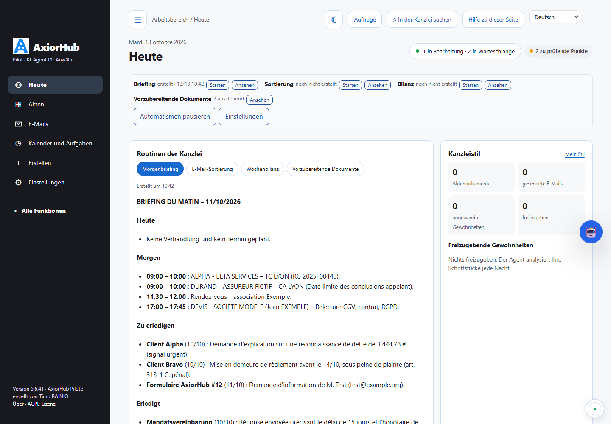
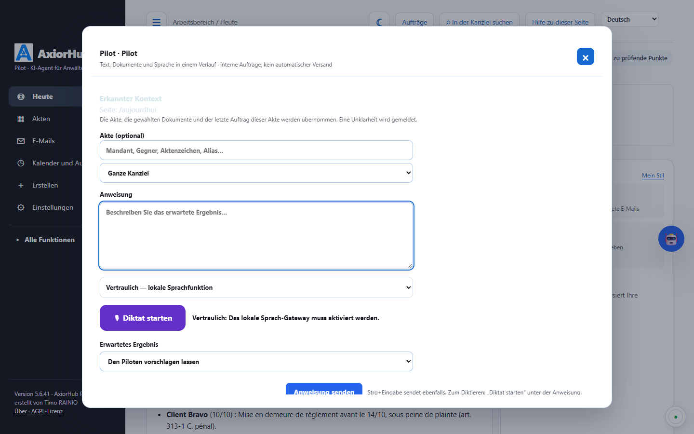
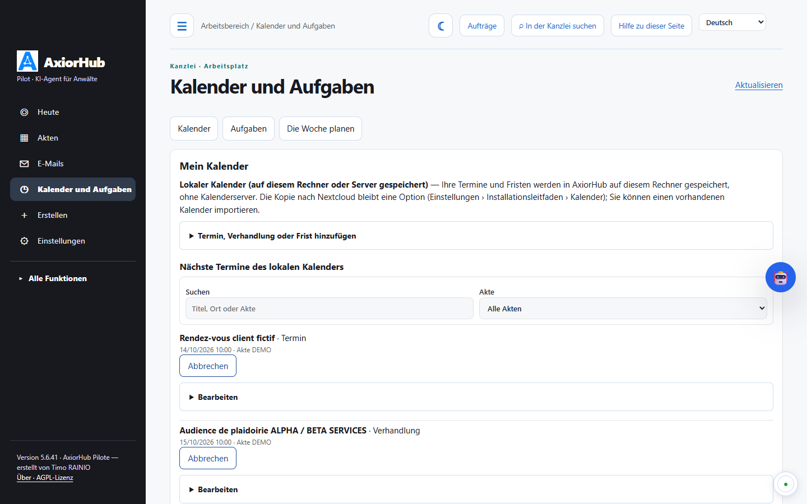
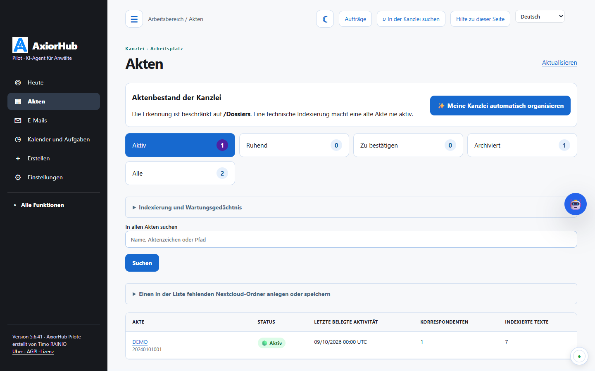
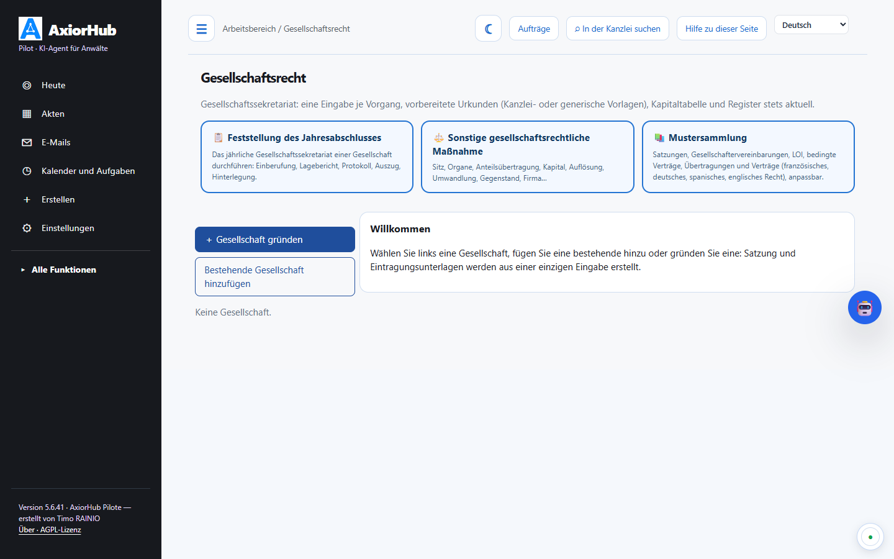
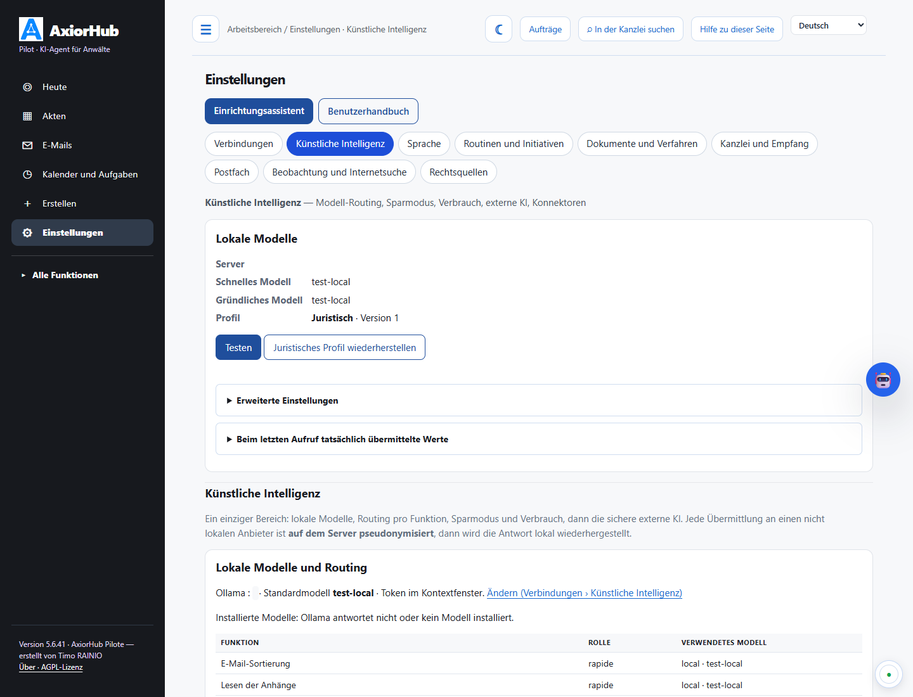
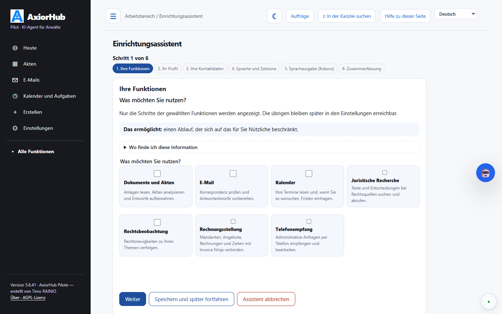
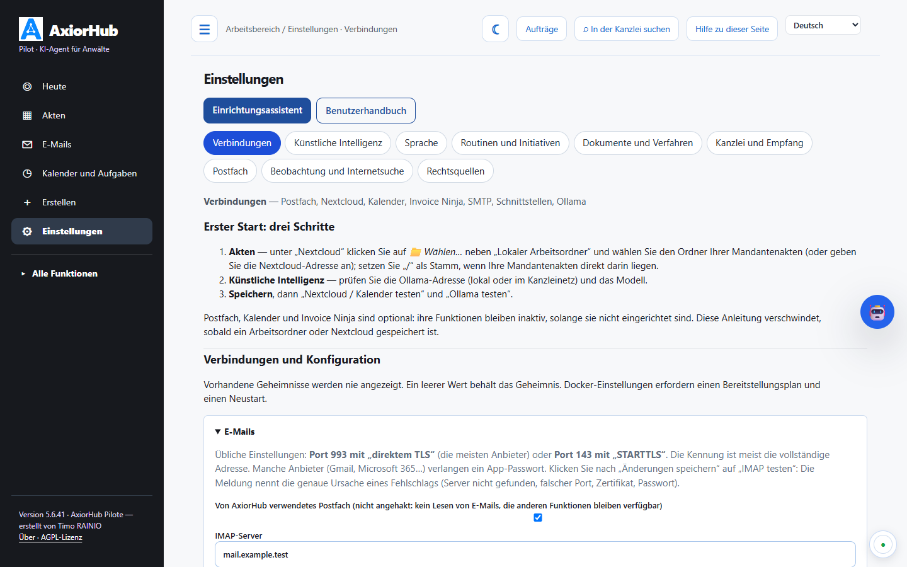
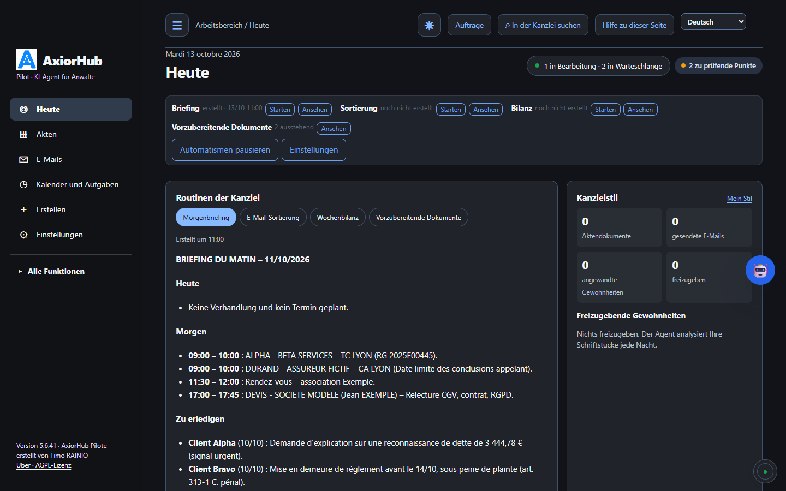

<p align="center"></p>

<h1 align="center">AxiorHub Pilote</h1>

<p align="center"><strong>Der KI-Ausführungsagent für die Anwaltskanzlei</strong><br>
E-Mails, Akten, Anlagen, Fristen, Kalender und Schriftsatzentwürfe, auf Ihrem eigenen Server, mit lokaler KI oder pseudonymisierter externer KI.</p>

<p align="center">Erstellt von <strong>Timo RAINIO</strong>, Rechtsanwalt (Barreau de Lyon) · Lizenz <a href="LICENSE">AGPL-3.0-or-later</a> · Version 5.6.41</p>

<p align="center"><a href="README.md">Français</a> · <a href="README.en.md">English</a> · <strong>Deutsch</strong> · <a href="README.es.md">Español</a></p>

<p align="center"><a href="docs/GUIDE-POSTE-10-MINUTES.md">Ubuntu-24.04-Arbeitsplatz: in zehn Minuten startklar (auf Französisch)</a> · <a href="docs/INSTALLATION-WINDOWS.md">Windows-11-Arbeitsplatz (auf Französisch)</a></p>

<p align="center"></p>

---

> Die Benutzeroberfläche ist auf Französisch (Standard), Englisch, Deutsch und Spanisch verfügbar. Die erzeugten
> juristischen Inhalte (Fristen, Verfahren, Rechtsquellen) sind für das **französische Recht** und die französischen
> Gerichte ausgelegt. Die ausführlichen Anleitungen in `docs/` sind auf Französisch verfasst.

AxiorHub Pilote liest das Postfach und die Akten der Kanzlei, versteht, was eingeht, und **bereitet die Arbeit vor**:
Antwortentwürfe, Schriftsatzentwürfe, Anlagenverzeichnisse, Fristen, Aufgaben. Es versendet nichts, unterschreibt nichts
und reicht nichts ein. Jedes Ergebnis ist ein Entwurf, den der Anwalt prüft, korrigiert und freigibt.

| | |
|---|---|
| **Für wen** | Einzelanwälte und kleine Kanzleien, mit ihren Mitarbeitern und Assistenten. |
| **Wo** | Auf dem Server der Kanzlei (ein VPS genügt) oder auf einem Windows- oder Ubuntu-Arbeitsplatz: Postfach und Nextcloud bleiben Ihre. |
| **Mit welcher KI** | Lokal (Ollama), extern (Anthropic, OpenAI, Mistral…) **pseudonymisiert**, oder beides. |
| **Was es nicht von selbst tut** | Eine E-Mail senden (nur Ihr Klick auf „Senden“, sofern erlaubt), unterschreiben, einreichen, einen Verfahrenstermin festlegen. |
| **Quellen** | Soweit möglich geprüft, nie garantiert: siehe „[Quellen und Kontrollen](#quellen-und-kontrollen-was-geprüft-wird-was-bei-ihnen-bleibt)“. |

## Was der Agent tut

### Das Cockpit

Der Bildschirm „Heute" bündelt, was den Anwalt erfordert:

- ein **Eingabefeld**: „Bereite die Antwort an den Kollegen zum Verfahrenskalender in der Akte LEROY vor".
  Der Agent errät die Akte, Sie können sie korrigieren. Sie können ein Dokument anhängen oder diktieren (Mikrofon);
- **Zu prüfen**: fertige E-Mail- und Dokumententwürfe, mit einem Klick zu öffnen;
- **Was der Agent tut**: laufende, beendete oder blockierte Arbeiten, mit dem Namen der bearbeiteten Anlage oder Anfrage;
- **Mein Tag**: Verhandlungen und Termine des Tages, Nextcloud-Aufgaben (die des Agenten und Ihre), Deck-Board;
- **Routinen**: Morgenbriefing, morgendliche E-Mail-Sortierung, Wochenbilanz. Das Briefing gibt es auch als
  ausformulierte **mündliche Zusammenfassung**, zum Lesen oder **Anhören** (Sprachausgabe der Kanzlei: Kokoro,
  Chatterbox oder espeak); jede Zahl der Zusammenfassung wird mit dem Briefing abgeglichen;
- **Rechtsbeobachtung**: datierte und belegte Neuigkeiten zu Ihren Themen;
- **Kanzleistil**: vorgeschlagene Schreibgewohnheiten, freizugeben.

Ein Band am unteren Seitenrand zeigt die Aktivität des Agenten live. Ein dunkler Modus ist verfügbar.

<p align="center"></p>

### Mit einem Klick prüfen und freigeben


Jeder Entwurf öffnet sich in einem Seitenbereich: vollständiger Text, zitierte Quellen, Punkte „ZU ERGÄNZEN". Sie können:
- den Entwurf **freigeben**;
- ihn **ignorieren**;
- ihn **im Editor öffnen** (Word online mit OnlyOffice) oder in Nextcloud;
- mit einem Satz eine **neue Fassung** anfordern („bestimmterer Ton", „Verhandlungstermin ergänzen").

Der Agent lernt aus diesen Entscheidungen.

### Genau wissen, was der Agent tut


Jede Arbeit öffnet sich mit ihren Details:
- die Akte;
- die analysierte Anlage, das angeforderte Dokument oder die betroffene E-Mail;
- die durchlaufenen Schritte und das Ergebnis;
- Links zum erzeugten Dokument;
- die Schaltfläche „Erneut starten" bei einer Blockade.

Der Bildschirm „Warum wird nichts erzeugt?" erklärt jede Störung: Dienste, Arbeitswarteschlange, Fehler und ihre Ursache,
Verbindungen, automatische Abnahmetests.

### E-Mails

- **Sortierung** eingehender Nachrichten: E-Mail eines Mandanten, eines Kollegen, eines Gerichts, RPVA-Benachrichtigung,
  Werbung, Verteiler, automatische Nachricht.
- **Zuordnung zur richtigen Akte** anhand der Korrespondenten, Aktenzeichen und des Verlaufs; im Zweifel wird ein
  Vorschlag gemacht, und die bestätigte Zuordnung gilt danach für folgende Nachrichten.
- **Antwortentwürfe** im Ordner Entwürfe Ihres Postfachs (IMAP), im ursprünglichen Verlauf, mit Ihrer Signatur.
  Nichts wird versendet.
- **Werkstatt „Zu prüfende E-Mails"**:
  - Text, Empfänger und Betreff ändern;
  - Korrekturen diktieren;
  - eine Umformulierung verlangen („kürzer", „höflicher", „Datum in Erinnerung rufen");
  - juristische Zitate prüfen;
  - eine Regel „immer so machen" speichern.
- **Postfach** (Reiter „Posteingang" unter „E-Mails"): Ordner des Postfachs (Eingang, Gesendet, Entwürfe, Papierkorb,
  Unterordner), Liste und Lesebereich nebeneinander, lesbare Anhänge; „Antwort beim Agenten anfordern" für eine
  gewählte E-Mail, mit Akte, ohne Akte oder mit neuer Akte, einer Anweisung und dem Text der Anhänge.
- **Postfachfunktionen**: antworten, allen antworten, weiterleiten, neue Nachricht (An, Cc, Bcc, formatierter Text,
  Anhänge), archivieren, verschieben, Spam, löschen (Papierkorb), gelesen / ungelesen, Nachverfolgung.
- **Postfacheinstellungen**: formatierte Signatur (neue Nachrichten, Antworten, Weiterleitungen), Schriftart und
  Schriftgröße, **automatisches Bcc** bei jeder Nachricht (auch bei den Entwürfen des Agenten) und **Ablageregeln**: je
  nach Betreff, Absender oder Empfänger wird die eingegangene E-Mail nach dem Lesen durch den Agenten in den gewählten
  Unterordner verschoben.
- **Versand**, standardmäßig deaktiviert. Wenn aktiviert, läuft er über eine Bestätigung mit Empfängern, Betreff und Anhängen.
- **Warum kein Entwurf?** Jede nicht bearbeitete E-Mail nennt ihren Grund (Nachricht der Kanzlei, Verteiler, unsichere
  Akte, Entscheidung des Anwalts nötig…) und den Weg zur Behebung.

### Dokumente und Schriftsatzentwürfe

- **Anfrage in natürlicher Sprache**: Schriftsatz, Klageschrift, Antrag, Schreiben, Mahnung, Vermerk, Gutachten, Vertrag.
  Der Entwurf entsteht aus der Akte (Anlagen, Tatsachen, Chronologie) und den **Vorlagen der Kanzlei**.
- **Automatische Ablage** in der Ordnerstruktur der Akte (PROCEDURE, CORRESPONDANCES, PROJETS, LIVRABLES).
- **Arbeitsordner**, vom Anwalt hinzugefügt: zum Beispiel `NOS PIECES` (eigene Anlagen) und
  `PIECES ADVERSES - {{partie_adverse01}}` (gegnerische Anlagen), wobei der Name mit den Gegenparteien jeder Akte ergänzt
  wird. Die KI weiß, von welcher Seite jede Anlage stammt.
- **Analyse der gesamten Akte**: jede Anlage hat eine Übersicht (datierte Tatsachen, Anträge, Beträge, Fundstellen, mit
  Seitenangabe); die KI prüft alle Anlagen in dem Detailgrad, den ihr Arbeitsspeicher erlaubt, und die Abdeckung wird
  angezeigt.
- **Neue Fassungen** auf Anweisung, ohne das Original zu überschreiben, auch für ein von Ihnen verfasstes Dokument.
- **Online-Bearbeitung** des Word-Dokuments im Browser (OnlyOffice), ohne Herunterladen.

### Anlagen und Anlagenverzeichnisse

- Lesen der PDF-Dateien der Akte, Vorschlag von **Reihenfolge**, **Bezeichnungen** und **Daten**.
- **Nummerierung** und **Stempel** „Pièce n° X" auf den Seiten, **Anlagenverzeichnis** in Word und PDF nach Ihrer Vorlage.
- **Einzelne PDF-Datei** mit einem Lesezeichen pro Anlage.
- **Neu nummerierte Verweise** im Schriftsatz, mit Änderungsverfolgung.
- **Aufteilung für die Einreichung über e-Barreau** nach der maximalen Sendungsgröße.
- Alles geschieht lokal, ohne KI, und erst nach Ihrem Bestätigungscode. Die Originaldateien werden nie verändert.

### Fristen, Kalender und Aufgaben

- **Verfahrensdokumente → Kalender → Entwürfe**: auf der Aktenseite wählen Sie die eingegangenen Dokumente; der Agent
  erkennt die genannten Termine, Sie wählen die einzutragenden Termine und die Kalender (Nextcloud, CalDAV, Google), dann
  bereitet er die Informationsentwürfe für Mandant und Kollegen vor. Nichts wird versendet.
- **Verfahrensmitteilungen** (Vertagung, Ladung, Zeitplan): die Termine werden aus dem Text entnommen und geprüft, in den
  Nextcloud-Kalender eingetragen, und eine Informations-E-Mail wird vorbereitet.
- **Verfahrensfristen**: das auslösende Ereignis (Zustellung, Mitteilung, Berufungseinlegung…) wird in der Anlage
  erkannt. Die Frist wird nach deterministischen Regeln berechnet, nie von der KI. Jedes Datum wird „zu bestätigen" mit
  seiner Berechnung vorgeschlagen, danach folgen gestaffelte Erinnerungen.
- **Verjährung und Ausschlussfristen**: versionierte Regeln mit ihren Artikeln, ausführliche Berechnung Schritt für Schritt.
- **Termin hinzufügen** unter „Kalender und Aufgaben", in einem oder mehreren eingerichteten Kalendern (Nextcloud,
  CalDAV, Google Kalender), mit Kontrolle jeder Eintragung.
- **Aufgaben**: einfache Liste nach Fälligkeit (überfällig, heute, diese Woche, später, ohne Fälligkeit), Filter nach
  Zeitraum und Akte, neue Aufgabe direkt daneben.
- Nextcloud-**Kalender und -Aufgaben** (CalDAV) und **Deck**: Arbeitsplan pro Akte, Aufgaben des Agenten und persönliche
  Aufgaben, Karten, die dem Fortschritt folgen.

<p align="center"></p>

### Akten

- **Aktenseite**: eine einzige übersichtliche Seite. Das vom Agenten vorbereitete Arbeitsblatt enthält die
  Zusammenfassung, den Sachverhalt, die Parteien (Stellung, Bevollmächtigter, Mandant der Kanzlei), das Verfahren und die
  Chronologie der entscheidenden Ereignisse, jeweils mit ihren Anlagen; der Anwalt korrigiert es direkt. Daneben: mit dem
  Agenten in der Akte arbeiten (Schreiben, Vermerk, Schriftsatz, Frage), Parteien, Verfahren, letzte E-Mails.
- **Steuerung des Agenten pro Akte**: „KI pausieren" (keine automatische Arbeit mehr), dauerhafte Anweisungen, automatische
  Wiederholungen nach drei Fehlschlägen in Folge ausgesetzt.
- Einheitliche **Chronologie** (E-Mails, Anlagen, Schriftstücke, Verhandlungen).
- **Aktentatsachen** aus den Anlagen (Aktenzeichen, Beträge, Daten, Parteien), jeweils mit Quelle, freizugeben.
- **Suche** in der ganzen Kanzlei (E-Mails, Dokumente, Akten).
- **Terminvorbereitung**: belegtes Blatt vor dem Termin, Protokollentwurf danach.

<p align="center"></p>

### Kanzleipraxis

- **Zeiten und Honorare**: aus der tatsächlichen Tätigkeit vorgeschlagene Zeiten, erst nach Freigabe gezählt; Budgets
  und Warnungen.
- **Interessenkonflikte**: Suche der Parteien in bestehenden Akten, belegter Bericht; keine Ausarbeitung für eine neue
  Akte, solange der Anwalt nicht entschieden hat.
- **Nachvollziehbare juristische Recherche**: eine Entscheidung wird an der aktivierten amtlichen Quelle nachgelesen, bevor sie
  als geprüft erscheint; sonst bleibt sie ein zu prüfender Hinweis.
- **Rechtsquellen**: Konnektoren JusticeLibre (ohne Schlüssel), OpenLegi, GoodLegal, LibreJustice und Legal Data Hunter,
  vor der Aktivierung geprüft (Verbindung, Suche, Lesen eines Textes).
- **Prüfung der Fundstellen** in einem Schriftstück („Prüfen"): Artikel, Gesetze, Entscheidungen und Zitate werden
  erkannt und anhand der aktivierten Quelle zum maßgeblichen Datum geprüft; jede Fundstelle wird als geprüft, erkannt, zu
  prüfen oder auffällig gekennzeichnet.
- **Geplante Rechtsbeobachtung**: Themen, amtliche Feeds, Rechtsquelle und Internetsuche mit Tavily (optional, begrenzt);
  ein Rahmen in „Heute" und eine Leseseite.
- **KI-Kompetenzen**: schriftliche Methoden, denen die KI für eine Art von Arbeit folgt. Drei sind integriert (darunter
  der [juristische Assistent](resources/skills/assistant-juridique/PROVENANCE.md) von Christophe Quézel-Ambrunaz,
  AGPL-3.0); Sie können eigene erstellen, importieren (SKILL.md oder .zip, nur Texte) oder zum Anpassen kopieren.
- **Verhandlungsvorbereitung** und Analyse der gegnerischen Schriftsätze (überwachte Entwürfe).

### Initiativen, Dokumentdaten, KI-Werkzeuge und Gesellschaftssekretariat (5.6.36)

- **Initiativen**: Bei Eingang einer Klage schlägt der Agent einen Plan vor (Akte „KLÄGER - BEKLAGTER - Referenz“, abgelegte Anhänge,
  Beteiligte, Termin im Kalender, E-Mail an den Mandanten, Vermerk zu den gegnerischen Argumenten, Entwurf der Bestellungsanzeige,
  Anforderung der Unterlagen beim Kollegen, Schreiben an das Gericht). Sie korrigieren die erkannten Angaben, deaktivieren Unnötiges
  und geben frei: Nur markierte Schritte werden ausgeführt, als Entwürfe.
- **Dokumentdaten**: Art, Datum, Parteien, Schlüsseldaten, Beträge, zitierte Normen und Anträge jedes Dokuments, jeweils „belegt“
  oder „zu prüfen“, kanzleiweit durchsuchbar; E-Mail-Anhänge in der Akte abgelegt.
- **KI-Werkzeuge**: Analyseraster (dieselben Kriterien aus jedem Dokument, mit dem Auszug zu jedem Wert), Verhandlungs-Playbooks als
  Änderungsverfolgung in einem Word-Vertrag, Bibliothek belegter, von einem Anwalt freigegebener Rechtsvermerke.
- **Gesellschaftsrecht**: „Feststellung des Jahresabschlusses“ und „Sonstige gesellschaftsrechtliche Maßnahme“ (Sitz, Organe,
  Anteilsübertragung, Kapital, Auflösung…); eine Eingabe aktualisiert Karte, Kapitaltabelle und Register und bereitet die Urkunden vor
  (Kanzlei- oder generische Vorlagen). Eigene Urkunden und Word-Vorlagen mit Variablen wie `{{ denomination }}` lassen sich hinzufügen. Nichts wird unterzeichnet oder eingereicht.
- **Kontakte & CRM**: Mandanten, Parteien, Kollegen und Gerichte, mit jeder Akte und Rolle verknüpft.
- **Zahlungserinnerungen**: jeden Morgen Mahnungsentwürfe für fällige Invoice-Ninja-Rechnungen, vor jedem Versand zu prüfen.
- **Microsoft**: Word-Add-In (Playbooks, Vermerke, Umformulierung im geöffneten Dokument) und Microsoft-365-Kalender.

<p align="center"></p>

### Kanzleistil

Der Agent liest Ihre endgültigen Schriftstücke (Verfahren, Korrespondenz, Entwürfe) und Ihre gesendeten E-Mails und
schlägt Ihre Gewohnheiten vor: Anrede- und Schlussformeln, üblicher Aufbau der Schriftsätze, Nummerierung der Teile,
Darstellung zitierter Entscheidungen, Überschrift des Antragsteils, wiederkehrende Formulierungen. Jeder Vorschlag sagt,
was er ändern wird; nach der Freigabe gelten sie für Entwürfe und Dokumente. Die übliche Länge ist nur ein automatisch
übermittelter Richtwert. Kein Satz mit einem Namen, einer Nummer oder einer Adresse wird übernommen.

### Eine externe KI, aber pseudonymisiert

<p align="center"></p>

Vor jedem Versand an eine nicht lokale KI werden Namen, Gesellschaften, Adressen, Telefonnummern, E-Mail-Adressen, IBAN
und Nummern durch Platzhalter ersetzt (`[PERSONNE_1]`, `[SOCIETE_1]`…). Die Zuordnungstabelle bleibt auf dem Server, und
die Antwort wird lokal wiederhergestellt. Die **Vorschau** zeigt genau, was gesendet würde. Drei Modi stehen zur Wahl:
- **alles lokal**;
- **gemischt**: Sortierung und Lesen lokal, Entwurf über die API;
- **alles über die API**, für einen VPS ohne Grafikkarte.

**Externe Ausweichlösung** (optional): braucht das lokale Modell mehr als 3 Minuten für einen Entwurf oder eine Ihrer
Anfragen, oder hat die Anfrage länger gewartet, wird sie dem ersten bereiten Anbieter übergeben (Mistral, dann Claude,
ChatGPT, OpenRouter), immer pseudonymisiert. Sortierung und Kontrollen bleiben lokal.

### Geführte Installation und Konten der Kanzlei

<p align="center">
&nbsp;</p>

- **Installationsassistent** Schritt für Schritt: Kanzlei, Postfach, Nextcloud, KI und Betriebsmodus. Jede Verbindung
  wird getestet und erhält einen Nachweis.
- **Konten und Rollen**: Administrator, Anwalt, Assistenz. Die Rechte werden vom Server geprüft und jeder Vorgang wird
  protokolliert (siehe [docs/COMPTES-ET-ROLES.md](docs/COMPTES-ET-ROLES.md), auf Französisch).

### Außerdem

- **Mobile App** (aus dem Browser installierbar) mit Benachrichtigungen: freizugebende E-Mails, Fristen, Suche.
- **Lokales Diktat** (optionales Gateway) für Anweisungen und Korrekturen.
- **Integrationen** in Roundcube (Schaltfläche im Webmail) und Open WebUI (Werkzeug für Unterhaltungen).
- **Geprüfte Aktualisierungen** (SHA-256-Manifest, Signatur, Rücksprung) und **automatische Abnahmetests** nach jeder
  Installation.
- **Oberfläche in vier Sprachen** (Französisch als Standard, Englisch, Deutsch, Spanisch), Menü „Alle Funktionen" und
  Benutzerhandbuch, das mit den tatsächlichen Bildschirmen verknüpft ist.

<p align="center"></p>

## Quellen und Kontrollen: was geprüft wird, was bei Ihnen bleibt

AxiorHub verringert das Fehlerrisiko; es beseitigt es nicht. Ein KI-Modell kann sich irren, ungenau zusammenfassen oder einen
Satz dem falschen Dokument zuordnen. Die Software sagt das, prüft, was sie prüfen kann, und weist auf den Rest hin.

**Verfügbare Kontrollen**
- **Tatsachen, Daten und Beträge aus Dokumenten**: jedes Element zitiert einen Auszug; ein Datum oder Betrag gilt nur als
  „belegt“, wenn er in diesem Auszug steht (gleiche Währung, gleiches Vorzeichen), sonst „zu prüfen“.
- **Entscheidungen und Texte**: eine von einem Recherche-Connector gefundene Entscheidung wird an der aktivierten amtlichen
  Quelle nachgelesen, bevor sie als geprüft erscheint; ist das nicht möglich, bleibt sie ein „Hinweis“.
- **Verweise in einem Schriftstück** („Prüfen“): Artikel, Gesetze, Entscheidungen und Zitate werden erfasst und an der
  aktivierten Quelle zum maßgeblichen Datum geprüft: geprüft, identifiziert, zu prüfen oder auffällig.
- **Gesprochene Zusammenfassung des Briefings**: jede Zahl wird mit dem schriftlichen Briefing verglichen.

**Grenzen**
- Der Abgleich eines Auszugs ist textuell: eine Umschreibung durch das Modell bleibt „zu prüfen“.
- Ein schlecht gescanntes Dokument (OCR) kann einen Auszug verfälschen; eine nicht verfügbare Quelle lässt den Verweis „zu prüfen“.
- Rechtliche Bedeutung, Tragweite und Aktualität eines Satzes werden durch diese Kontrollen nicht garantiert.
- Die Übersetzungen der Oberfläche und der Berichte sind nicht von einem juristischen Übersetzer geprüft.

**Was bei Ihnen bleibt**
Öffnen Sie vor jedem Zitat die amtliche Quelle, lesen Sie jeden Entwurf vor der Freigabe und klären Sie jedes Element „zu prüfen“
vor der Verwendung. Kein Ergebnis von AxiorHub ersetzt Ihre berufliche Prüfung.

## Vertraulichkeit zuerst

- **Eine Installation = eine Kanzlei.** Die Daten bleiben auf Ihrem Server (Postfach, Nextcloud, lokale Datenbank).
- **Standardmäßig lokale KI.** Eine externe KI wird nur mit Ihrer ausdrücklichen Zustimmung aktiviert, und jeder Text,
  der den Server verlässt, ist pseudonymisiert.
- **Es werden keine Daten an den Autor der Software übermittelt.** Keine Telemetrie.
- Die Abbildungen in diesem Dokument verwenden **ausschließlich fiktive Daten**.

Einzelheiten: [docs/CONFIDENTIALITE.md](docs/CONFIDENTIALITE.md) (auf Französisch).

## Installation

AxiorHub Pilote gibt es in drei Versionen. **Für die Arbeit der Kanzlei wählen Sie die Serverversion**; die Arbeitsplatzversionen sind
für eine einzelne Anwältin oder einen einzelnen Anwalt am eigenen Computer oder zum Ausprobieren gedacht. Die ausführlichen Anleitungen
sind auf Französisch.

| Version | Wofür | Zugriff | Ausführliche Anleitung |
|---|---|---|---|
| **Linux-Server** (Ubuntu 24.04 LTS, Debian 12) — **empfohlen** | die Kanzlei, alle ihre Computer, die Nextcloud-App | HTTPS, von jedem Computer | unten, [VPS schlüsselfertig](docs/INSTALLATION-VPS.md), [vorhandener Server](docs/INSTALLATION-SERVEUR.md), [Docker](DOCKER-INSTALLATION.md) |
| **Arbeitsplatz Windows 11** | eine Person am eigenen Computer, Test | nur dieser Computer | [docs/INSTALLATION-WINDOWS.md](docs/INSTALLATION-WINDOWS.md) |
| **Arbeitsplatz Ubuntu 24.04** | eine Person am eigenen Computer, Test | nur dieser Computer | [docs/GUIDE-POSTE-10-MINUTES.md](docs/GUIDE-POSTE-10-MINUTES.md) |

### 1. Serverversion (Linux) — empfohlen

**Voraussetzungen**: ein Server mit Ubuntu 24.04 LTS oder Debian 12 (64 Bit) und `sudo`-Zugang; mindestens 8 GB Arbeitsspeicher ohne
lokale KI (32 GB und idealerweise eine Grafikkarte für lokale KI); 80 GB Festplatte; ein Domainname mit HTTPS; die Einstellungen des
Kanzleipostfachs (IMAP, SMTP); Nextcloud (bereits vorhanden oder vom VPS-Skript installiert).

**Neuer Server (VPS)**: AxiorHub Pilote, Nextcloud, Roundcube, OnlyOffice, Apache und HTTPS mit Let's Encrypt in einem Durchgang —
folgen Sie der [vollständigen Installation auf einem VPS, Schritt für Schritt](#vollständige-installation-auf-einem-vps-schritt-für-schritt)
weiter unten.

**Vorhandener Server** (Nextcloud und Apache bereits eingerichtet):

```bash
# 1. Server vorbereiten
sudo apt update && sudo apt full-upgrade -y
sudo apt install -y git python3 python3-venv

# 2. AxiorHub Pilote herunterladen und das geprüfte Archiv bauen (Prüfsummenmanifest, vom Installer kontrolliert)
sudo git clone --branch v5.6.41 https://github.com/Arthur-Llevelys/AxiorHub-Pilote.git /opt/axiorhub-src
cd /opt/axiorhub-src
sudo python3 scripts/build-release.py /tmp/axiorhub-mail-agent-5.6.41.tar.gz

# 3. Installieren (oder aktualisieren): Code in /opt/axiorhub-mail-agent, Konfiguration in /etc/axiorhub-mail-agent
cd /tmp && tar -xzf axiorhub-mail-agent-5.6.41.tar.gz && cd axiorhub-mail-agent-5.6.41
sudo bash install.sh

# 4. Postfach, Nextcloud, Kalender und KI einrichten (Passwörter verdeckt eingegeben), dann prüfen
sudo axiorhub-mail configure
sudo axiorhub-mail doctor

# 5. Oberfläche unter dem vorhandenen HTTPS-Namen veröffentlichen (https://cloud.ihre-kanzlei.example/agent-courriel/)
sudo python3 /opt/axiorhub-mail-agent/current/install-interface.py
```

Alternative: Das Debian-Paket `axiorhub-pilote_5.6.41_all.deb` (`sudo apt install ./axiorhub-pilote_5.6.41_all.deb`, gebaut mit
`scripts/build-deb.py`, siehe [Entwickeln](#entwickeln)) ersetzt Schritt 3; die Schritte 4 und 5 bleiben. Zum Aktualisieren das Archiv
der neuen Version ausführen (`sudo bash install.sh`); schlägt es fehl, bleibt die bisherige Version aktiv (zurück:
`sudo python3 upgrade.py --rollback`).

### 2. Arbeitsplatz Windows 11

**Voraussetzungen**: Windows 11 (64 Bit) und Microsoft Edge (vorinstalliert); [Ollama für Windows](https://ollama.com/download/windows)
oder ein externer KI-Anbieter; optional: Tesseract OCR, LibreOffice. Python ist enthalten.

1. Laden Sie `AxiorHub-Pilote-Setup-5.6.41.exe` und die zugehörige `.sha256`-Datei von der Seite *Releases* des Repositorys herunter,
   oder bauen Sie sie (`python scripts\build-windows.py dist\windows`).
2. Prüfsumme in PowerShell kontrollieren: `Get-FileHash .\AxiorHub-Pilote-Setup-5.6.41.exe -Algorithm SHA256`.
3. Installer starten (ohne Administratorrechte). Zeigt SmartScreen „Der Computer wurde durch Windows geschützt“: **Weitere
   Informationen › Trotzdem ausführen**.
4. **AxiorHub Pilote** im Startmenü öffnen: Das Fenster öffnet sich, bereits angemeldet, auf den ersten Einstellungen.

Daten: `%LOCALAPPDATA%\AxiorHub Pilote\donnees`; Aktualisierung: den Installer der neuen Version starten (Daten bleiben erhalten).

### 3. Arbeitsplatz Ubuntu 24.04

**Voraussetzungen**: Ubuntu 24.04 (64 Bit) und ein Konto mit `sudo`; Ollama mit einem Modell (auf diesem Computer, GPU empfohlen, oder
auf einem anderen Rechner der Kanzlei).

```bash
# Ollama und ein Modell (etwa 5 GB Download)
curl -fsSL https://ollama.com/install.sh | sh
ollama pull qwen3:8b

# AxiorHub Pilote (Paket und .sha256 von der Seite Releases des Repositorys)
sha256sum -c axiorhub-pilote-poste_5.6.41_amd64.deb.sha256
sudo apt install ./axiorhub-pilote-poste_5.6.41_amd64.deb
```

**AxiorHub Pilote** über das Anwendungsmenü starten (oder `axiorhub-pilote` im Terminal): Das Fenster öffnet sich, bereits angemeldet,
auf dem Einrichtungsassistenten. Lokales Passwort: `axiorhub-pilote --print-password`.

Die Arbeitsplatzversionen sind nur vom eigenen Computer aus erreichbar (`http://127.0.0.1:8769`), ohne HTTPS und ohne automatische
Sicherung: Für eine Kanzlei ist die Serverversion vorzuziehen.

### 4. Erste Einstellungen (alle Versionen)

Beim ersten Öffnen führt der **Einrichtungsassistent** (Einstellungen › Einrichtungsassistent) Bildschirm für Bildschirm: genutzte
Funktionen, Profil, Kontaktdaten, Sprache und Zeitzone, Sprachausgabe, Zusammenfassung. Nur die Schritte der gewählten Funktionen werden
angezeigt; während des Assistenten wird nichts gesendet und nichts ins Postfach geschrieben.

<p align="center">
&nbsp;</p>

Dann **Einstellungen › Verbindungen**:

1. **Akten**: lokaler Arbeitsordner („📁 Wählen…“, zum Beispiel ein vom Nextcloud-Client synchronisierter Ordner) oder Nextcloud
   (HTTPS-Adresse, Benutzername, App-Passwort);
2. **Künstliche Intelligenz**: Ollama (lokal oder auf einem Rechner der Kanzlei) oder ein externer Anbieter, immer **pseudonymisiert**;
3. **Postfach** (optional): IMAP (Port 993 oder 143 mit STARTTLS), Ordner „Entwürfe“;
4. **Kalender** (optional): Nextcloud, CalDAV oder Google Kalender.

Jeder Bereich hat eine eigene Testschaltfläche. Beginnen Sie im Modus **Beobachtung** (nichts wird geschrieben), wechseln Sie nach
einigen Tagen in den Modus **Entwürfe** und aktivieren Sie die Automatismen dann einzeln.

### 5. Nextcloud-App „AxiorHub Pilote“

Die [Nextcloud-App](https://github.com/Arthur-Llevelys/AxiorHub-Pilote-Nextcloud/blob/main/README.en.md) zeigt die Oberfläche von
AxiorHub in Nextcloud (Nextcloud App Store: **Apps › Büro & Text › AxiorHub Pilote**). Sie benötigt die **Serverversion**; aktivieren
Sie sie unter **Einstellungen › Verbindungen › Nextcloud-App**, dann verknüpft jede Anwältin und jeder Anwalt das eigene Konto in
Nextcloud (Persönliche Einstellungen › AxiorHub Pilote).

Mit einer **Arbeitsplatzversion** funktioniert sie nur im **Testmodus, für Tests**: Nextcloud auf demselben Computer (Adresse
`http://127.0.0.1:8769/agent-courriel`, dauerhafter Warnhinweis) oder ein einfacher Link „Mein lokales AxiorHub“ aus einer gehosteten
Nextcloud. AxiorHub ist dann nur von diesem Computer aus erreichbar, und der lokale Austausch ist nicht verschlüsselt: niemals für den
Produktivbetrieb.

### Vollständige Installation auf einem VPS, Schritt für Schritt

Rechnen Sie mit etwa einer Stunde, einschließlich der Verbreitung der Domainnamen. Die Beispiele verwenden die Domain
`ihre-kanzlei.example`: ersetzen Sie sie überall durch Ihre eigene.

1. **Server mieten**: Debian 12 oder Ubuntu 24.04; mindestens 8 GB Arbeitsspeicher ohne lokale KI (32 GB und idealerweise
   eine Grafikkarte für lokale KI); mindestens 80 GB Speicherplatz; ein Rechenzentrum in der Europäischen Union.
   Hinterlegen Sie Ihren SSH-Schlüssel und notieren Sie die IPv4- (und IPv6-)Adresse.
2. **Domainname**: behalten Sie die bestehende Domain der Kanzlei; es werden nur vier Subdomains ergänzt.
3. **DNS-Zone**: legen Sie einen **A**-Eintrag (und **AAAA** bei IPv6) auf den VPS an für `agent` (AxiorHub Pilote),
   `cloud` (Nextcloud), `webmail` (Roundcube) und `office` (OnlyOffice). Die **MX**-Einträge bleiben unverändert.
   Prüfen mit `nslookup agent.ihre-kanzlei.example`.
4. **Erste Verbindung**:

   ```bash
   ssh debian@IP_DES_VPS
   sudo apt update && sudo apt full-upgrade -y
   sudo apt install -y git unattended-upgrades
   sudo dpkg-reconfigure -plow unattended-upgrades
   ```

   Öffnen Sie die Ports **22**, **80** und **443**, falls Ihr Anbieter eine Netzwerk-Firewall verwendet.
5. **Herunterladen**:

   ```bash
   sudo git clone https://github.com/Arthur-Llevelys/AxiorHub-Pilote.git /opt/axiorhub-src
   cd /opt/axiorhub-src
   ```

6. **Installieren**: `sudo bash deploy/vps/install-vps.sh`. Das Skript fragt nach der Domain der Kanzlei, den vier
   Adressen, der E-Mail für Let's Encrypt, den IMAP/SMTP-Servern des Postfachs und ob die lokale KI aktiviert werden soll.
   Es installiert Docker, Apache und Certbot, erzeugt `deploy/vps/.env` mit **allen Passwörtern**, startet die Container,
   holt die HTTPS-Zertifikate und richtet Nextcloud ein (Kalender, Aufgaben, Deck, Kontakte, OnlyOffice). Es kann gefahrlos
   erneut ausgeführt werden.
7. **Die Datei `.env`** enthält Einstellungen und Passwörter; sie ist nur für den Administrator lesbar und darf **nie**
   veröffentlicht oder per E-Mail versandt werden. Nach jeder Änderung:
   `cd /opt/axiorhub-src/deploy/vps && sudo docker compose --env-file .env up -d`.
8. **Nextcloud**: als `admin` anmelden, für jedes Kanzleimitglied ein Konto und ein technisches Konto `axiorhub` anlegen,
   den Aktenordner (zum Beispiel `/Dossiers`) und die Kalender der Kanzlei mit ihm teilen und ein **App-Passwort** für
   `axiorhub` erzeugen.
9. **Postfach**: IMAP-Server und Port (meist 993), Benutzername und Passwort (oder App-Passwort) und die genauen Namen
   der Ordner Entwürfe und Gesendet bereithalten.
10. **Erster Administrator**: den privaten Registrierungscode mit
    `sudo cat deploy/vps/data/axiorhub/auth/bootstrap-token` lesen, `https://agent.ihre-kanzlei.example/signup` öffnen und
    dem **Installationsassistenten** folgen (Kanzlei, Postfach, Nextcloud, KI, Modus). Beginnen Sie im **Beobachtungsmodus**.
11. **Inbetriebnahme**: einige Tage im Beobachtungsmodus lassen, die Zuordnung der E-Mails zu den Akten prüfen, dann in
    den Modus **Entwürfe** wechseln und die Automatismen einzeln aktivieren.
12. **Prüfen, sichern, aktualisieren**:

    ```bash
    cd /opt/axiorhub-src/deploy/vps
    sudo docker compose --env-file .env ps
    echo '30 2 * * * root bash /opt/axiorhub-src/deploy/vps/backup.sh /var/backups/axiorhub' | sudo tee /etc/cron.d/axiorhub-backup
    cd /opt/axiorhub-src && sudo git pull && cd deploy/vps && sudo docker compose --env-file .env up -d --build
    ```

    Die Sicherungen enthalten Mandantendaten: **verschlüsseln Sie sie, kopieren Sie sie außerhalb des Servers** und
    testen Sie eine Wiederherstellung.

## Architektur

```
            Internet (HTTPS, Let's Encrypt)
                         │
                  Apache (virtuelle Hosts)
     ┌──────────────┬───────────┴───┬────────────────┐
 agent.…         cloud.…        webmail.…        office.…
 AxiorHub Pilote Nextcloud      Roundcube        OnlyOffice
 (8626)          (8080)         (8081)           (8082)
   │  Worker, IMAP-Überwachung          │
   ├── IMAP/SMTP der Kanzlei ───────────┘
   ├── WebDAV / CalDAV Nextcloud
   └── KI: lokales Ollama (Option) │ pseudonymisierte externe API (Option)
```

Siehe [docs/ARCHITECTURE.md](docs/ARCHITECTURE.md) (auf Französisch).

## Entwickeln

```bash
python3 -m unittest discover -s tests -p 'test_*.py' -q
python3 scripts/privacy-scan.py
python3 scripts/build-release.py dist/axiorhub-mail-agent-5.6.41.tar.gz
python3 scripts/build-deb.py dist/axiorhub-pilote_5.6.41_all.deb --archive dist/axiorhub-mail-agent-5.6.41.tar.gz
python scripts/build-windows.py dist/windows   # unter Windows, nach pip install -r scripts/windows-requirements.txt
```

Python 3.11 oder neuer, Standardbibliothek für den Kern, Waitress als Webserver; Poppler, Tesseract und LibreOffice für
PDF, Texterkennung und Dokumente. Mitwirken: [CONTRIBUTING.md](CONTRIBUTING.md) · Sicherheit: [SECURITY.md](SECURITY.md) ·
Verlauf: [CHANGELOG.md](CHANGELOG.md).

## Lizenz und Urhebervermerk

Der Code steht unter der **GNU Affero General Public License v3.0 oder später**. Sie dürfen ihn verwenden, untersuchen,
ändern und weitergeben; wenn Sie eine geänderte Fassung Nutzern über ein Netzwerk anbieten, müssen Sie ihnen Zugang zu
ihrem Quellcode geben.

Zusätzliche Bedingung (Abschnitt 7 b der AGPL): jede geänderte oder weitergegebene Fassung behält den Vermerk
**„AxiorHub Pilote — créé par Timo RAINIO"** in der Datei `NOTICE`, auf der Seite „Über" und in der Fußzeile des Menüs.

Der Name AxiorHub Pilote und das Logo fallen nicht unter die AGPL: siehe [TRADEMARKS.md](TRADEMARKS.md) und
[LOGO-LICENSE.md](LOGO-LICENSE.md). Eine geänderte Fassung muss einen eigenen Namen tragen.

> AxiorHub Pilote ist ein Vorbereitungswerkzeug. Es ersetzt weder das Urteil noch die Verantwortung des Anwalts: jedes
> Ergebnis muss vor Versand, Unterzeichnung, Einreichung oder Weitergabe an Dritte geprüft werden.
