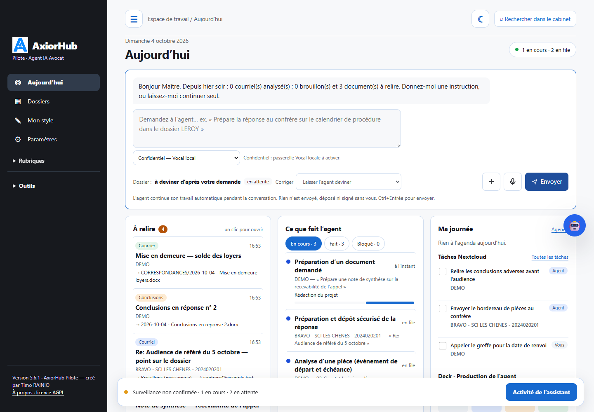
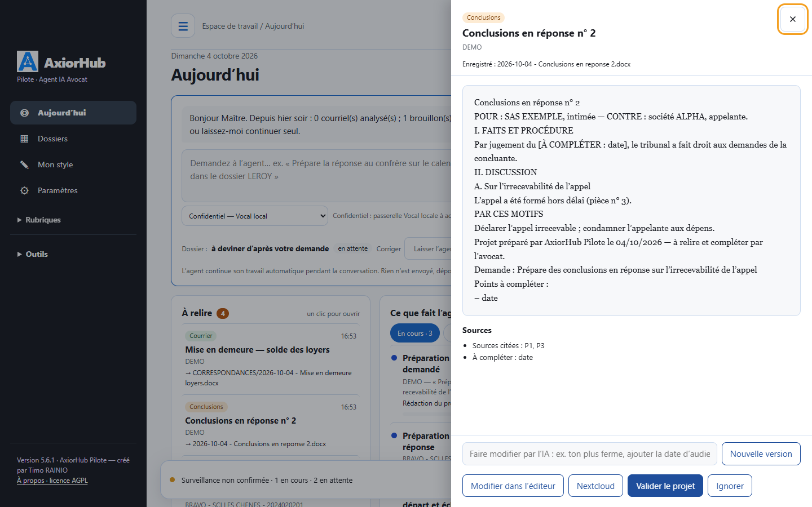
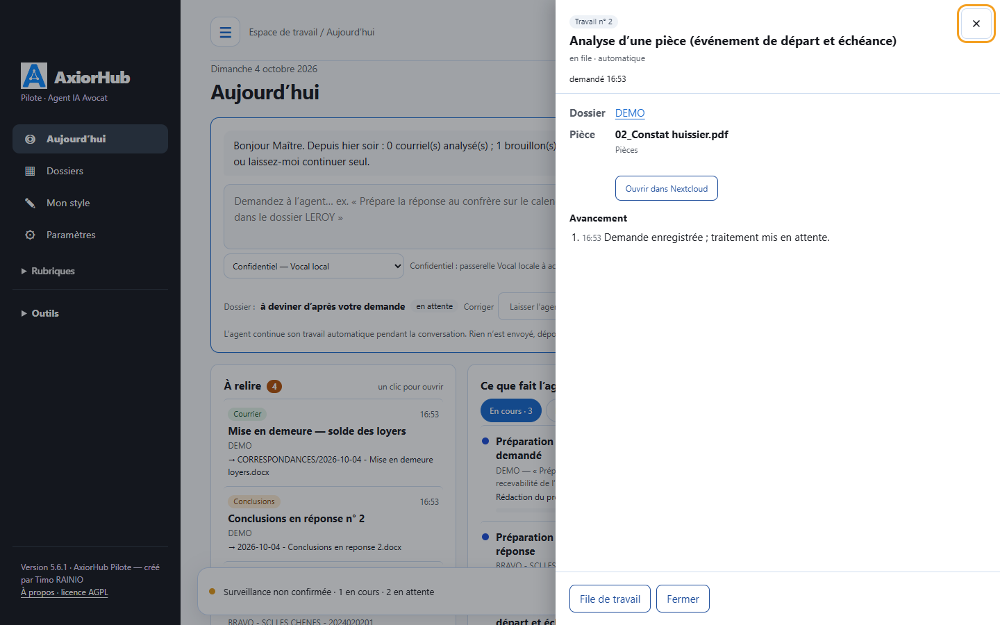
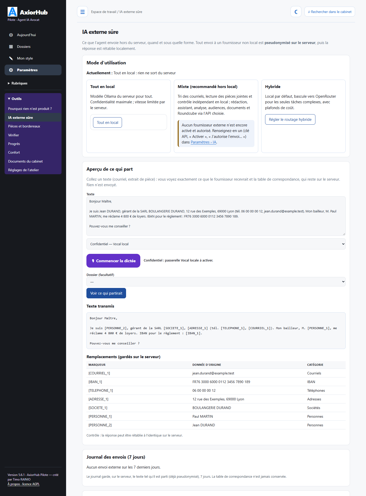
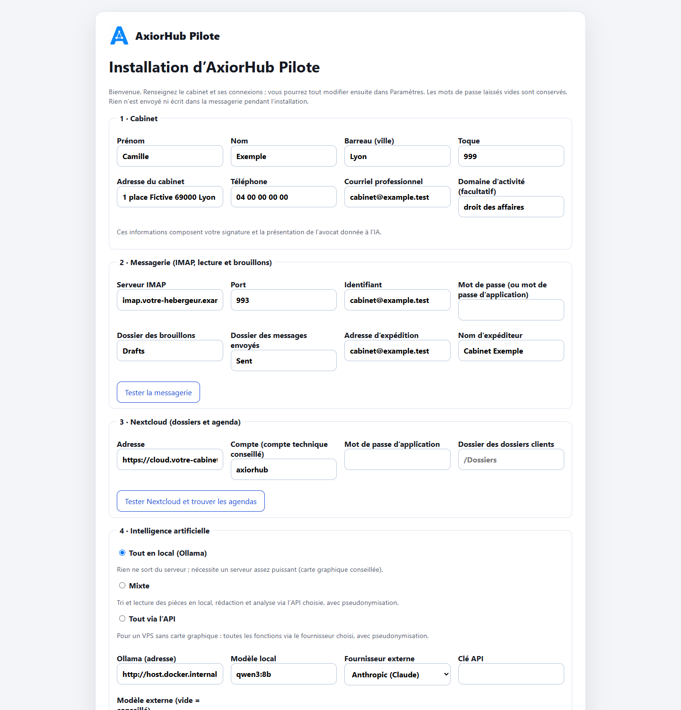
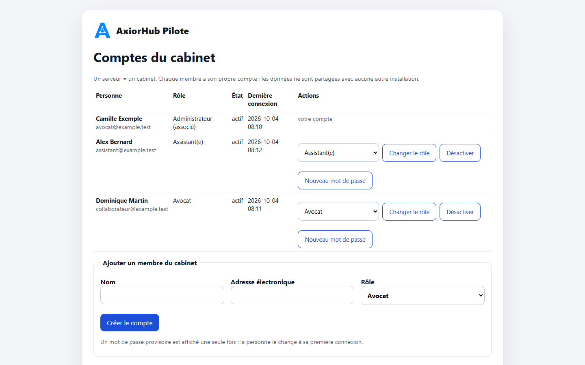
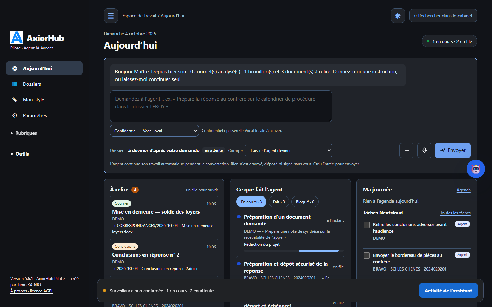

<p align="center"></p>

<h1 align="center">AxiorHub Pilote</h1>

<p align="center"><strong>The AI execution agent for law firms</strong><br>
Emails, case files, exhibits, deadlines, calendar and draft documents, on your own server, with a local AI or a pseudonymised external AI.</p>

<p align="center">Created by <strong>Timo RAINIO</strong>, member of the Lyon Bar · Licence <a href="LICENSE">AGPL-3.0-or-later</a> · Version 5.6.34</p>

<p align="center"><a href="README.md">Français</a> · <strong>English</strong> · <a href="README.de.md">Deutsch</a> · <a href="README.es.md">Español</a></p>

<p align="center"><a href="docs/GUIDE-POSTE-10-MINUTES.md">Ubuntu 24.04 workstation: up and running in ten minutes (in French)</a> · <a href="docs/INSTALLATION-WINDOWS.md">Windows 11 workstation (in French)</a></p>

<p align="center"></p>

---

> The software interface is available in French (default), English, German and Spanish. The legal content it produces
> (deadlines, procedure, legal sources) is designed for **French law** and French courts. The detailed guides in `docs/`
> are written in French.

AxiorHub Pilote reads the firm's mailbox and case files, understands what comes in and **prepares the work**:
draft replies, draft documents, exhibit lists, deadlines, tasks. It sends nothing, signs nothing and files nothing.
Every output is a draft that the lawyer reviews, corrects and approves.

| | |
|---|---|
| **For whom** | Lawyers practising alone or in small firms, with their associates and assistants. |
| **Where** | On the firm's server (a VPS is enough) or on a Windows or Ubuntu workstation: the mailbox and Nextcloud remain yours. |
| **Which AI** | Local (Ollama), external (Anthropic, OpenAI, Mistral…) **pseudonymised**, or both. |
| **What it never does** | Send an email, sign, file, set a procedural date on its own, invent a source. |

## What the agent does

### The cockpit

The "Today" screen gathers what needs the lawyer's attention:

- an **input box**: "Prepare the reply to opposing counsel about the procedural timetable in the LEROY case".
  The agent guesses the case file, which you can correct. You can attach a document or dictate (microphone);
- **To review**: draft emails and documents ready to open in one click;
- **What the agent is doing**: work in progress, finished or blocked, with the name of the exhibit or request handled;
- **My day**: today's hearings and appointments, Nextcloud tasks (the agent's and yours), Deck board;
- **Routines**: morning briefing, morning email triage, weekly review. The briefing also comes as a written
  **spoken summary**, to read or to **listen to** (the firm's speech synthesis: Kokoro, Chatterbox or espeak);
  every number in the summary is checked against the briefing;
- **Legal watch**: dated and sourced updates on your topics;
- **Firm style**: suggested writing habits, to be approved.

A banner at the bottom of the page shows the agent's activity live. A dark mode is available.

### Review and approve in one click

<p align="center"></p>

Each draft opens in a panel: full text, cited sources, "TO BE COMPLETED" items. You can:
- **approve** the draft;
- **ignore** it;
- **open it in the editor** (Word online with OnlyOffice) or in Nextcloud;
- ask for a **new version** in one sentence ("firmer tone", "add the hearing date").

The agent learns from these decisions.

### Know exactly what the agent does

<p align="center"></p>

Each task opens on its detail:
- the case file;
- the exhibit analysed, the document requested or the email concerned;
- the steps completed and the result;
- links to open the file produced;
- a "Retry" button if it is blocked.

The "Why is nothing produced?" screen explains any failure: services, work queue, errors and their cause,
connections, automatic acceptance tests.

### Emails

- **Triage** of incoming messages: email from a client, opposing counsel, a court, an RPVA notification, advertising,
  mailing list, automatic message.
- **Linking to the right case file** based on correspondents, references and history; when in doubt, a suggestion
  is made and the confirmed link is then used for later messages.
- **Draft replies** placed in the Drafts folder of your mailbox (IMAP), in the original thread, with your signature.
  Nothing is sent.
- **"Emails to review" workshop**:
  - edit the text, recipient and subject;
  - dictate corrections;
  - ask for a rewording ("shorter", "more courteous", "add a reminder of the date");
  - check legal citations;
  - save a rule "always do it this way".
- **Mailbox** ("Inbox" tab of "Emails"): mailbox folders (inbox, sent, drafts, trash, sub-folders), list and reading
  side by side, readable attachments; "Ask the agent for a reply" for a chosen email, with a case file, without one or by
  creating a new case file, an instruction and the text of the attachments.
- **Mail functions**: reply, reply all, forward, new message (To, Cc, Bcc, formatted text, attachments), archive, move,
  junk, delete (trash), read / unread, follow-up.
- **Mail settings**: formatted signature (new messages, replies, forwards), font and size, **automatic Bcc** on every
  message (including the agent's drafts) and **filing rules**: depending on the subject, the sender or a recipient, the
  incoming email is moved to the chosen sub-folder after the agent has read it.
- **Sending**, disabled by default. When enabled, it goes through a confirmation summarising recipients, subject and
  attachments.
- **Why no draft?** Each unprocessed email shows its reason (message from the firm, mailing list, uncertain case file,
  lawyer's decision needed…) and how to fix it.

### Documents and draft deeds

- **Natural-language requests**: pleadings, summons, petition, letter, formal notice, memo, opinion, contract. The draft
  is written from the case file (exhibits, facts, chronology) and the **firm's templates**.
- **Automatic filing** in the case folder tree (PROCEDURE, CORRESPONDANCES, PROJETS, LIVRABLES).
- **Working folders** added by the lawyer: for example `NOS PIECES` (our exhibits) and
  `PIECES ADVERSES - {{partie_adverse01}}` (opposing exhibits), the name being completed with each case's opposing
  parties. The AI knows which side each exhibit comes from.
- **Whole-case analysis**: each exhibit has a summary card (dated facts, claims, amounts, references, with the page);
  the AI examines every exhibit at the level of detail its working memory allows, and coverage is displayed.
- **New versions** on instruction, without overwriting the original, including for a document you wrote.
- **Online editing** of the Word document in the browser (OnlyOffice), without downloading.

### Exhibits and exhibit lists

- Reading the case PDFs, suggesting the **order**, **titles** and **dates**.
- **Numbering** and "Pièce n° X" **stamp** on the pages, Word and PDF **exhibit list** from your template.
- **Single PDF** with one bookmark per exhibit.
- **Renumbered references** in the pleadings, with tracked changes.
- **Splitting for e-Barreau filing** according to the maximum upload size.
- Everything runs locally, without AI, and only after your confirmation code. Original files are never modified.

### Deadlines, calendar and tasks

- **Procedural documents → calendar → drafts**: on the case page, choose the documents received; the agent extracts the
  dates they quote, you choose which to record and in which calendars (Nextcloud, CalDAV, Google), then it prepares the
  information drafts for the client and opposing counsel. Nothing is sent.
- **Procedural notices** (adjournment, summons, timetable): dates are extracted and checked in the text, recorded in the
  Nextcloud calendar, and an information email is prepared.
- **Procedural deadlines**: the triggering event (service, notification, notice of appeal…) is located in the exhibit.
  The time limit is calculated by deterministic rules, never by the AI. Each date is proposed "to be confirmed" with its
  calculation, then reminders are issued in cascade.
- **Limitation and foreclosure periods**: versioned rules with their articles, detailed step-by-step calculation.
- **Add an event** from "Calendar and tasks", in one or more configured calendars (Nextcloud, CalDAV, Google Calendar),
  with each deposit read back.
- **Tasks**: simple list grouped by due date (overdue, today, this week, later, no due date), filters by period and case
  file, adding a task right next to it.
- Nextcloud **calendar and tasks** (CalDAV) and **Deck**: work plan per case, agent tasks and personal tasks, cards that
  follow the progress of production.

### Case files

- **Case page**: one clear page. The work sheet prepared by the agent gives the summary, the written statement of facts,
  the parties (capacity, counsel, firm's client), the procedure and the chronology of decisive events, each item with its
  exhibits; the lawyer corrects it in place. Next to it: work with the agent in the case (letter, memo, pleadings,
  question), parties, procedure, latest emails.
- **Control of the agent per case**: "Pause the AI" (no more automatic work), standing instructions followed by the
  agent, automatic retries suspended after three consecutive failures.
- Unified **chronology** (emails, exhibits, deeds, hearings).
- **Case facts** extracted from the exhibits (docket number, amounts, dates, parties), each with its source, to approve.
- **Search** across the whole firm (emails, documents, case files).
- **Meeting preparation**: sourced sheet before the meeting, draft minutes afterwards.

### Practice

- **Time and fees**: time entries proposed from actual activity, counted only once approved; budgets and alerts.
- **Conflicts of interest**: search for the parties in existing case files, sourced report; no production for a new
  case file until the lawyer has decided.
- **Traceable legal research**: a decision is cited only after checking it against the official source.
- **Legal sources**: connectors JusticeLibre (no key), OpenLegi, GoodLegal, LibreJustice and Legal Data Hunter, checked
  (connection, search, reading a text) before being enabled.
- **Reference check** in a document ("Verify"): articles, statutes, decisions and quotations are extracted and checked
  against the enabled source, at the relevant date; each reference is marked checked, identified, to verify or anomalous.
- **Scheduled legal watch**: topics, official feeds, legal source and Tavily Internet search (optional, capped); a frame
  in "Today" and a reading page.
- **AI skills**: written methods the AI follows for a type of work. Three are built in (including Christophe
  Quézel-Ambrunaz's [legal assistant](resources/skills/assistant-juridique/PROVENANCE.md), AGPL-3.0); you can create,
  import (SKILL.md or .zip, text only) or copy them to adapt them.
- **Hearing preparation** and analysis of the opposing party's submissions (supervised drafts).

### Firm style

The agent reads your final documents (procedure, correspondence, drafts) and your sent emails, then suggests your habits:
opening and closing formulas, usual structure of pleadings, numbering of parts, presentation of cited decisions, heading
of the operative part, recurring phrases. Each suggestion says what it will change; once approved, they apply to drafts
and documents. The usual length is only a guide passed on automatically. No sentence containing a name, number or
address is kept.

### An external AI, but pseudonymised

<p align="center"></p>

Before anything is sent to a non-local AI, names, companies, addresses, phone numbers, emails, IBANs and numbers are
replaced by markers (`[PERSONNE_1]`, `[SOCIETE_1]`…). The mapping table stays on the server and the answer is restored
locally. The **preview** shows exactly what would be sent. Three modes are available:
- **all local**;
- **mixed**: triage and reading locally, drafting via the API;
- **all via the API**, for a VPS without a graphics card.

**External fallback** (optional): if the local model takes more than 3 minutes for drafting or one of your requests, or if
the request has waited longer for its turn, it is handed to the first ready provider (Mistral, then Claude, ChatGPT,
OpenRouter), always pseudonymised. Email triage and checks remain local.

### Guided installation and firm accounts

<p align="center">
&nbsp;</p>

- **Installation guide** step by step: firm, mailbox, Nextcloud, AI and operating mode. Each connection is tested and
  receives a receipt.
- **Accounts and roles**: administrator, lawyer, assistant. Rights are enforced by the server and every operation is
  logged (see [docs/COMPTES-ET-ROLES.md](docs/COMPTES-ET-ROLES.md), in French).

### And also

- **Mobile app** (installable from the browser) with notifications: emails to approve, deadlines, search.
- **Local voice dictation** (optional gateway) for instructions and corrections.
- **Integrations** with Roundcube (button in the webmail) and Open WebUI (tool for conversations).
- **Verified updates** (SHA-256 manifest, signature, rollback) and **automatic acceptance tests** after each installation.
- **Interface in four languages** (French by default, English, German, Spanish), "All functions" menu and user guide
  linked to the actual screens.

<p align="center"></p>

## Privacy first

- **One installation = one firm.** Data stays on your server (mailbox, Nextcloud, local database).
- **Local AI by default.** An external AI is enabled only with your explicit consent, and any text that leaves is
  pseudonymised.
- **No data is sent to the author of the software.** No telemetry.
- The screenshots in this document use **fictitious data only**.

Details: [docs/CONFIDENTIALITE.md](docs/CONFIDENTIALITE.md) (in French).

## Installation

| Situation | Guide (in French) |
|---|---|
| **New VPS** (OVH or other): AxiorHub Pilote + Nextcloud + Roundcube + OnlyOffice, Apache, Let's Encrypt HTTPS | steps below, details in [docs/INSTALLATION-VPS.md](docs/INSTALLATION-VPS.md) |
| **Windows 11 workstation**: desktop application, installer without administrator rights | [docs/INSTALLATION-WINDOWS.md](docs/INSTALLATION-WINDOWS.md) |
| **Ubuntu 24.04 workstation**: `.deb` package | [docs/GUIDE-POSTE-10-MINUTES.md](docs/GUIDE-POSTE-10-MINUTES.md) |
| Existing server, AxiorHub Pilote alone in Docker | [DOCKER-INSTALLATION.md](DOCKER-INSTALLATION.md) |
| Existing server, system installation (systemd), upgrading an earlier version | [docs/INSTALLATION-SERVEUR.md](docs/INSTALLATION-SERVEUR.md) |

### Full installation on a VPS, step by step

Allow about an hour, including domain name propagation. The examples use the domain `your-firm.example`: replace it
everywhere with your own.

1. **Rent the server**: Debian 12 or Ubuntu 24.04; at least 8 GB of memory without local AI (32 GB and ideally a
   graphics card for local AI); at least 80 GB of disk; a data centre in the European Union. Add your SSH key and note
   the server's IPv4 (and IPv6) address.
2. **Domain name**: keep the firm's existing domain if it has one; only four sub-domains are added.
3. **DNS zone**: create an **A** record (and **AAAA** if you have IPv6) pointing to the VPS for `agent` (AxiorHub
   Pilote), `cloud` (Nextcloud), `webmail` (Roundcube) and `office` (OnlyOffice). Do not touch the **MX** records.
   Check with `nslookup agent.your-firm.example`.
4. **First connection**:

   ```bash
   ssh debian@VPS_IP
   sudo apt update && sudo apt full-upgrade -y
   sudo apt install -y git unattended-upgrades
   sudo dpkg-reconfigure -plow unattended-upgrades
   ```

   Open ports **22**, **80** and **443** if your host uses a network firewall.
5. **Download**:

   ```bash
   sudo git clone https://github.com/Arthur-Llevelys/AxiorHub-Pilote.git /opt/axiorhub-src
   cd /opt/axiorhub-src
   ```

6. **Install**: `sudo bash deploy/vps/install-vps.sh`. The script asks for the firm's domain, the four addresses, the
   Let's Encrypt email, the mailbox IMAP/SMTP servers and whether to enable local AI. It installs Docker, Apache and
   Certbot, creates `deploy/vps/.env` **generating all passwords**, starts the containers, obtains the HTTPS certificates
   and configures Nextcloud (Calendar, Tasks, Deck, Contacts, OnlyOffice). It can be run again safely.
7. **The `.env` file** holds the settings and passwords; it is readable only by the administrator and must **never** be
   published or emailed. After any change: `cd /opt/axiorhub-src/deploy/vps && sudo docker compose --env-file .env up -d`.
8. **Nextcloud**: sign in as `admin`, create an account for each member of the firm and a technical account `axiorhub`,
   share the case-files folder (for example `/Dossiers`) and the firm's calendars with it, and create an **app
   password** for `axiorhub`.
9. **Mailbox**: have the IMAP server and port (usually 993), the login and password (or an app password) and the exact
   names of the Drafts and Sent folders ready.
10. **First administrator**: read the private sign-up code with
    `sudo cat deploy/vps/data/axiorhub/auth/bootstrap-token`, open `https://agent.your-firm.example/signup`, then follow
    the **installation guide** (firm, mailbox, Nextcloud, AI, mode). Start in **observation** mode.
11. **Getting started**: leave AxiorHub Pilote in observation for a few days, check the links between emails and case
    files, then switch to **drafts** mode and enable automations one by one.
12. **Check, back up, update**:

    ```bash
    cd /opt/axiorhub-src/deploy/vps
    sudo docker compose --env-file .env ps
    echo '30 2 * * * root bash /opt/axiorhub-src/deploy/vps/backup.sh /var/backups/axiorhub' | sudo tee /etc/cron.d/axiorhub-backup
    cd /opt/axiorhub-src && sudo git pull && cd deploy/vps && sudo docker compose --env-file .env up -d --build
    ```

    Backups contain client data: **encrypt them, copy them off the server** and test a restore.

## Architecture

```
            Internet (HTTPS, Let's Encrypt)
                         │
                  Apache (virtual hosts)
     ┌──────────────┬───────────┴───┬────────────────┐
 agent.…         cloud.…        webmail.…        office.…
 AxiorHub Pilote Nextcloud      Roundcube        OnlyOffice
 (8626)          (8080)         (8081)           (8082)
   │  workers, IMAP monitoring          │
   ├── firm IMAP/SMTP ──────────────────┘
   ├── Nextcloud WebDAV / CalDAV
   └── AI: local Ollama (option) │ pseudonymised external API (option)
```

See [docs/ARCHITECTURE.md](docs/ARCHITECTURE.md) (in French).

## Development

```bash
python3 -m unittest discover -s tests -p 'test_*.py' -q
python3 scripts/privacy-scan.py
python3 scripts/build-release.py dist/axiorhub-mail-agent-5.6.34.tar.gz
python3 scripts/build-deb.py dist/axiorhub-pilote_5.6.34_all.deb --archive dist/axiorhub-mail-agent-5.6.34.tar.gz
python scripts/build-windows.py dist/windows   # on Windows, after pip install -r scripts/windows-requirements.txt
```

Python 3.11 or later, standard library for the core, Waitress for the web server; Poppler, Tesseract and LibreOffice
for PDFs, OCR and documents. Contributing: [CONTRIBUTING.md](CONTRIBUTING.md) · Security: [SECURITY.md](SECURITY.md) ·
History: [CHANGELOG.md](CHANGELOG.md).

## Licence and attribution

The code is distributed under the **GNU Affero General Public License v3.0 or later**. You may use, study, modify and
redistribute it; if you offer a modified version to users over a network, you must give them access to its source code.

Additional condition (section 7 b of the AGPL): any modified or redistributed version keeps the notice
**"AxiorHub Pilote — créé par Timo RAINIO"** in the `NOTICE` file, the "About" page and the menu footer.

The AxiorHub Pilote name and logo are not covered by the AGPL: see [TRADEMARKS.md](TRADEMARKS.md) and
[LOGO-LICENSE.md](LOGO-LICENSE.md). A modified version must carry its own name.

> AxiorHub Pilote is a preparation tool. It replaces neither the lawyer's judgement nor their responsibility: every output
> must be reviewed before sending, signing, filing or communicating it to a third party.
