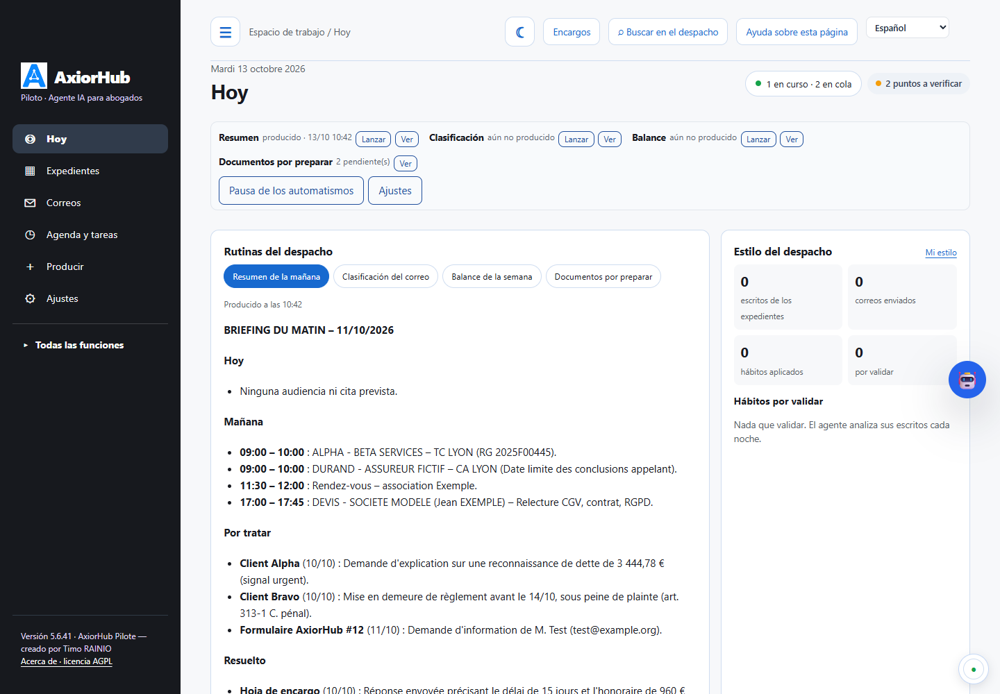
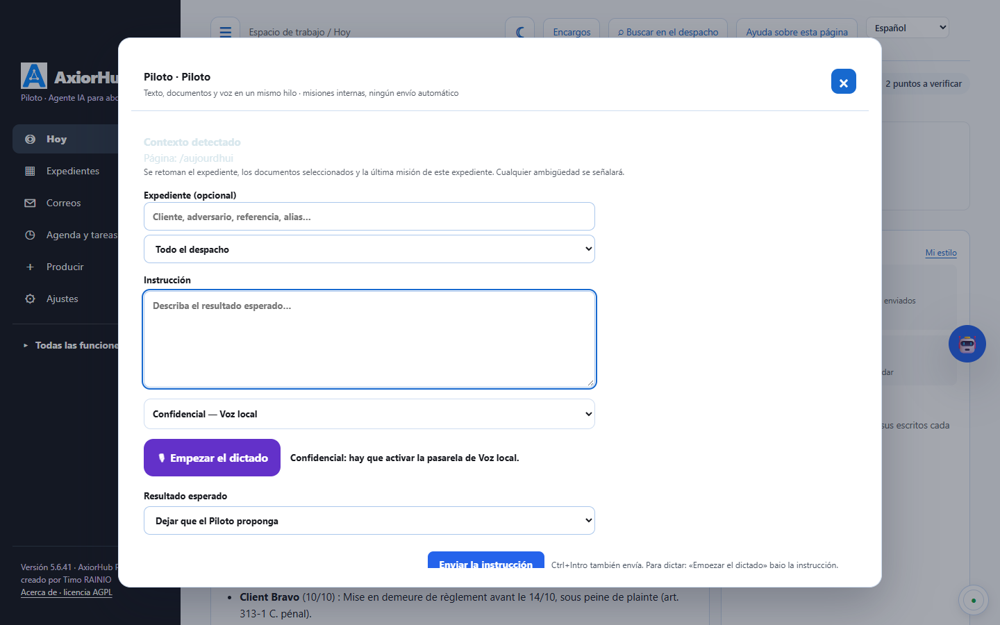
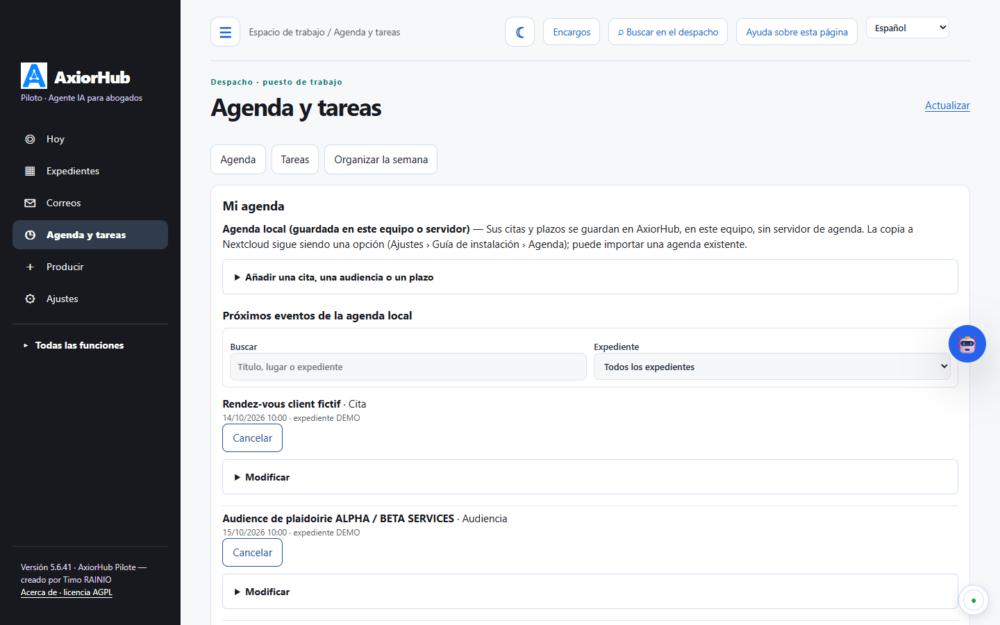
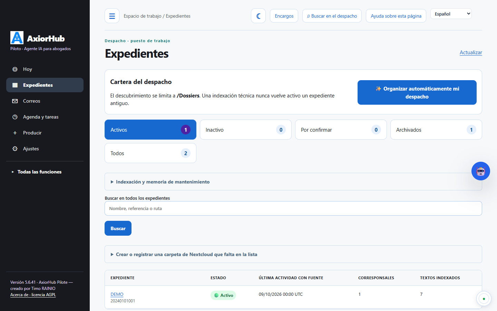
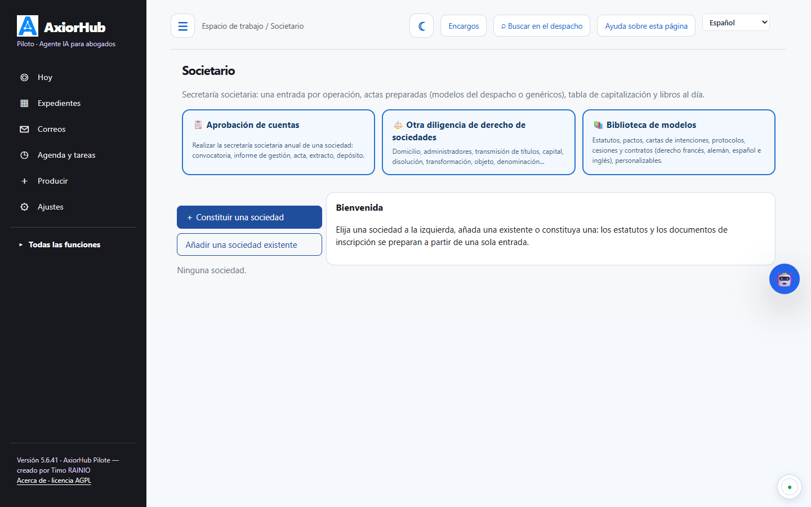
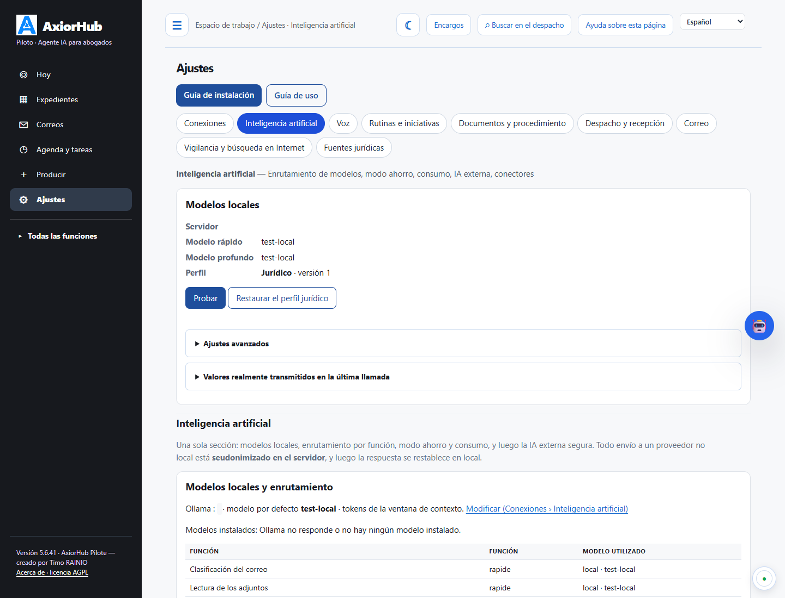
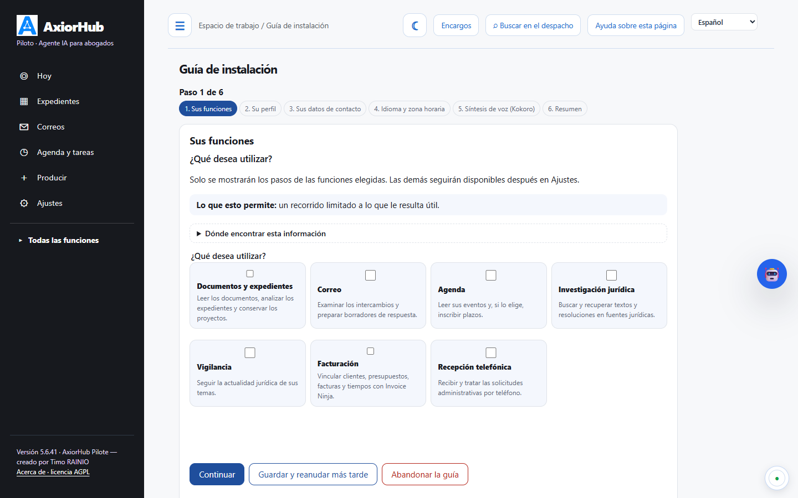
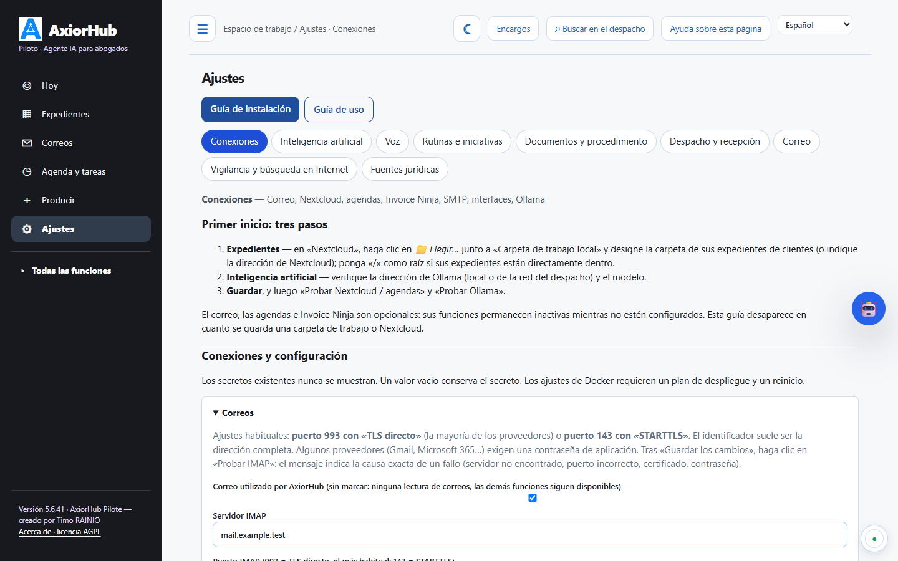
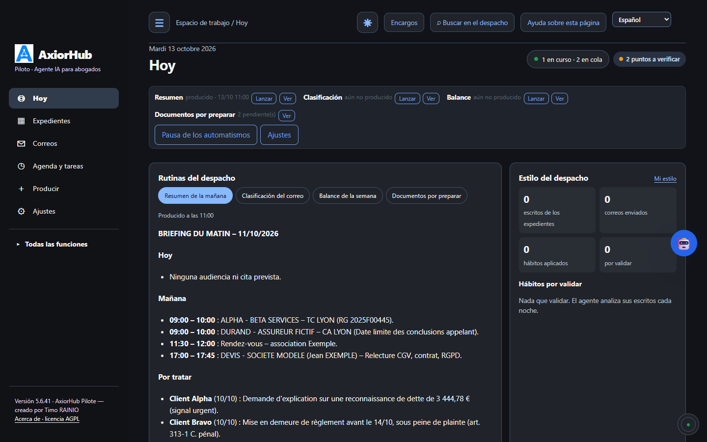

<p align="center"></p>

<h1 align="center">AxiorHub Pilote</h1>

<p align="center"><strong>El agente de IA de ejecución del despacho de abogados</strong><br>
Correos, expedientes, documentos, plazos, agenda y proyectos de escritos, en su propio servidor, con una IA local o una IA externa seudonimizada.</p>

<p align="center">Creado por <strong>Timo RAINIO</strong>, abogado del Colegio de Lyon · Licencia <a href="LICENSE">AGPL-3.0-or-later</a> · Versión 5.6.57</p>

<p align="center"><a href="README.md">Français</a> · <a href="README.en.md">English</a> · <a href="README.de.md">Deutsch</a> · <strong>Español</strong></p>

<p align="center"><a href="docs/GUIDE-POSTE-10-MINUTES.md">Puesto Ubuntu 24.04: en marcha en diez minutos (en francés)</a> · <a href="docs/INSTALLATION-WINDOWS.md">Puesto Windows 11 (en francés)</a></p>

<p align="center"></p>

---

> La interfaz está disponible en francés (por defecto), inglés, alemán y español. El contenido jurídico que produce
> (plazos, procedimiento, fuentes jurídicas) está concebido para el **Derecho francés** y los tribunales franceses. Las
> guías detalladas de `docs/` están redactadas en francés.

AxiorHub Pilote lee el correo y los expedientes del despacho, comprende lo que llega y **prepara el trabajo**:
borradores de respuesta, proyectos de escritos, índices de documentos, plazos, tareas. No envía nada, no firma nada y no
presenta nada. Cada resultado es un borrador que el abogado revisa, corrige y valida.

| | |
|---|---|
| **Para quién** | Abogados que ejercen solos o en pequeños despachos, con sus colaboradores y asistentes. |
| **Dónde** | En el servidor del despacho (basta un VPS) o en un puesto Windows o Ubuntu: el correo y Nextcloud siguen siendo suyos. |
| **Con qué IA** | Local (Ollama), externa (Anthropic, OpenAI, Mistral…) **seudonimizada**, o ambas. |
| **Lo que no hace por sí solo** | Enviar un correo (solo su clic en «Enviar», si lo ha autorizado), firmar, presentar, fijar una fecha procesal. |
| **Fuentes** | Controladas en la medida de lo posible, nunca garantizadas: véase «[Fuentes y controles](#fuentes-y-controles-qué-se-verifica-y-qué-le-corresponde-a-usted)». |

## Lo que hace el agente

### El puesto de pilotaje

La pantalla «Hoy» reúne lo que requiere al abogado:

- una **zona de entrada**: «Prepara la respuesta al compañero sobre el calendario procesal en el expediente LEROY».
  El agente deduce el expediente, que usted puede corregir. Puede adjuntar un documento o dictar (micrófono);
- **Por revisar**: borradores de correos y documentos listos, abiertos con un clic;
- **Lo que hace el agente**: trabajos en curso, terminados o bloqueados, con el nombre del documento o de la solicitud;
- **Mi jornada**: audiencias y citas del día, tareas de Nextcloud (las del agente y las suyas), tablero Deck;
- **Rutinas**: resumen de la mañana, clasificación matinal del correo, balance de la semana. El resumen existe también
  como **resumen oral** redactado, para leer o **escuchar** (síntesis de voz del despacho: Kokoro, Chatterbox o espeak);
  cada número del resumen se coteja con el original;
- **Vigilancia jurídica**: novedades fechadas y con fuente sobre sus temas;
- **Estilo del despacho**: hábitos de redacción propuestos, por validar.

Una banda en la parte inferior muestra la actividad del agente en directo. Hay un modo oscuro.

<p align="center"></p>

### Revisar y validar con un clic


Cada proyecto se abre en un panel: texto completo, fuentes citadas, puntos «POR COMPLETAR». Puede:
- **validar** el proyecto;
- **ignorarlo**;
- **abrirlo en el editor** (Word en línea con OnlyOffice) o en Nextcloud;
- pedir una **nueva versión** en una frase («tono más firme», «añadir la fecha de la audiencia»).

El agente aprende de estas decisiones.

### Saber exactamente lo que hace el agente


Cada trabajo se abre con su detalle:
- el expediente;
- el documento analizado, el documento solicitado o el correo afectado;
- las etapas cumplidas y el resultado;
- los enlaces para abrir el archivo producido;
- el botón «Relanzar» en caso de bloqueo.

La pantalla «¿Por qué no se produce nada?» explica cualquier avería: servicios, cola de trabajo, errores y su causa,
conexiones, pruebas automáticas.

### Correos

- **Clasificación** de los mensajes entrantes: correo de un cliente, de un compañero, de un tribunal, notificación RPVA,
  publicidad, lista de difusión, mensaje automático.
- **Vinculación al expediente correcto** según los corresponsales, las referencias y el historial; en caso de duda se
  hace una propuesta, y la vinculación confirmada sirve después para los mensajes siguientes.
- **Borradores de respuesta** depositados en la carpeta Borradores de su correo (IMAP), en el hilo original, con su
  firma. No se envía nada.
- **Taller «Correos por revisar»**:
  - modificar el texto, el destinatario y el asunto;
  - dictar correcciones;
  - pedir una reformulación («más corto», «más cortés», «recordar la fecha»);
  - verificar las citas jurídicas;
  - guardar una regla «hacerlo siempre así».
- **Buzón** (pestaña «Bandeja de entrada» de «Correos»): carpetas del buzón (entrada, enviados, borradores, papelera,
  subcarpetas), lista y lectura lado a lado, adjuntos legibles; «Pedir una respuesta al agente» para un correo elegido,
  con expediente, sin expediente o creando uno nuevo, una instrucción y el texto de los adjuntos.
- **Funciones de correo**: responder, responder a todos, reenviar, nuevo mensaje (Para, Cc, Cco, texto con formato,
  adjuntos), archivar, mover, correo no deseado, eliminar (papelera), leído / no leído, seguimiento.
- **Ajustes del correo**: firma con formato (mensajes nuevos, respuestas, reenvíos), tipo y tamaño de letra, **copia
  oculta automática** en cada mensaje (incluidos los borradores del agente) y **reglas de clasificación**: según el
  asunto, el remitente o un destinatario, el correo recibido se mueve a la subcarpeta elegida, después de que el agente
  lo haya leído.
- **Envío**, desactivado por defecto. Si se activa, pasa por una confirmación que resume destinatarios, asunto y adjuntos.
- **¿Por qué no hay borrador?** Cada correo no tratado indica su motivo (mensaje del despacho, lista de difusión,
  expediente incierto, decisión del abogado necesaria…) y cómo corregirlo.

### Documentos y proyectos de escritos

- **Solicitud en lenguaje natural**: conclusiones, demanda, solicitud, carta, requerimiento, nota, dictamen, contrato. El
  proyecto se redacta a partir del expediente (documentos, hechos, cronología) y de las **plantillas del despacho**.
- **Archivo automático** en la estructura de carpetas del expediente (PROCEDURE, CORRESPONDANCES, PROJETS, LIVRABLES).
- **Carpetas de trabajo** añadidas por el abogado: por ejemplo `NOS PIECES` (nuestros documentos) y
  `PIECES ADVERSES - {{partie_adverse01}}` (documentos de la parte contraria), completándose el nombre con las partes
  contrarias de cada expediente. La IA sabe de qué lado procede cada documento.
- **Análisis del expediente completo**: cada documento tiene su ficha (hechos fechados, pretensiones, importes,
  referencias, con la página); la IA examina todos los documentos con el nivel de detalle que permite su memoria de
  trabajo, y se muestra la cobertura.
- **Nuevas versiones** por instrucción, sin sobrescribir el original, incluso para un documento redactado por usted.
- **Edición en línea** del documento Word en el navegador (OnlyOffice), sin descarga.

### Documentos e índices

- Lectura de los PDF del expediente, propuesta de **orden**, **títulos** y **fechas**.
- **Numeración** y **sello** «Pièce n° X» en las páginas, **índice** Word y PDF a partir de su plantilla.
- **PDF único** con un marcador por documento.
- **Remisiones renumeradas** en las conclusiones, con control de cambios.
- **División para la presentación en e-Barreau** según el tamaño máximo de envío.
- Todo se hace en local, sin IA, y solo después de su código de confirmación. Los archivos originales nunca se modifican.

### Plazos, agenda y tareas

- **Documentos procesales → agenda → borradores**: en la página del expediente, elija los documentos recibidos; el
  agente detecta las fechas citadas, usted elige cuáles inscribir y en qué agendas (Nextcloud, CalDAV, Google), y luego
  prepara los borradores de información para el cliente y el compañero. No se envía nada.
- **Avisos procesales** (aplazamiento, citación, calendario): las fechas se extraen y verifican en el texto, se inscriben
  en la agenda de Nextcloud y se prepara un correo informativo.
- **Plazos procesales**: el hecho que inicia el plazo (notificación, emplazamiento, declaración de apelación…) se
  identifica en el documento. El plazo se calcula con reglas deterministas, nunca con la IA. Cada fecha se propone «por
  confirmar» con su cálculo, y después se emiten recordatorios escalonados.
- **Prescripción y caducidad**: reglas versionadas con sus artículos, cálculo detallado paso a paso.
- **Añadir un evento** desde «Agenda y tareas», en una o varias agendas configuradas (Nextcloud, CalDAV, Google
  Calendar), con verificación de cada inscripción.
- **Tareas**: lista sencilla agrupada por vencimiento (vencidas, hoy, esta semana, más tarde, sin vencimiento), filtros
  por periodo y expediente, añadir una tarea justo al lado.
- **Agenda y tareas** de Nextcloud (CalDAV) y **Deck**: plan de trabajo por expediente, tareas del agente y personales,
  tarjetas que siguen el avance de la producción.

<p align="center"></p>

### Expedientes

- **Página del expediente**: una sola página clara. La ficha de trabajo preparada por el agente da el resumen, la
  relación de hechos, las partes (calidad, abogado, cliente del despacho), el procedimiento y la cronología de los hechos
  determinantes, cada elemento con sus documentos; el abogado la corrige allí mismo. Al lado: trabajar con el agente en
  el expediente (carta, nota, conclusiones, pregunta), partes, procedimiento, últimos correos.
- **Control del agente por expediente**: «Pausar la IA» (ningún trabajo automático), instrucciones permanentes,
  reintentos automáticos suspendidos tras tres fallos seguidos.
- **Cronología** unificada (correos, documentos, escritos, audiencias).
- **Hechos del expediente** extraídos de los documentos (número de procedimiento, importes, fechas, partes), cada uno con
  su fuente, por validar.
- **Búsqueda** en todo el despacho (correos, documentos, expedientes).
- **Preparación de reuniones**: ficha con fuentes antes de la reunión, proyecto de acta después.

<p align="center"></p>

### Ejercicio profesional

- **Tiempo y honorarios**: tiempos propuestos a partir de la actividad real, contabilizados solo una vez validados;
  presupuestos y alertas.
- **Conflictos de intereses**: búsqueda de las partes en los expedientes existentes, informe con fuentes; ningún trabajo
  para un expediente nuevo mientras el abogado no haya decidido.
- **Investigación jurídica trazada**: una resolución se vuelve a leer en la fuente oficial activada antes de presentarse como
  verificada; si no, queda como pista por verificar.
- **Fuentes jurídicas**: conectores JusticeLibre (sin clave), OpenLegi, GoodLegal, LibreJustice y Legal Data Hunter,
  verificados (conexión, búsqueda, lectura de un texto) antes de activarlos.
- **Control de las referencias** en un escrito («Verificar»): artículos, leyes, resoluciones y citas se detectan y se
  controlan con la fuente activada, en la fecha útil; cada referencia se marca como controlada, identificada, por
  verificar o anómala.
- **Vigilancia jurídica programada**: temas, fuentes oficiales, fuente jurídica y búsqueda en Internet con Tavily
  (opcional, limitada); un recuadro en «Hoy» y una página de lectura.
- **Competencias de la IA**: métodos escritos que la IA sigue para un tipo de trabajo. Tres están integradas (entre
  ellas el [asistente jurídico](resources/skills/assistant-juridique/PROVENANCE.md) de Christophe Quézel-Ambrunaz,
  AGPL-3.0); puede crearlas, importarlas (SKILL.md o .zip, solo textos) o copiarlas para adaptarlas.
- **Preparación de audiencias** y análisis de los escritos contrarios (proyectos supervisados).

### Iniciativas, datos de los documentos, herramientas IA y secretaría societaria (5.6.36)

- **Iniciativas**: al recibir una demanda, el agente propone un plan (expediente «DEMANDANTE - DEMANDADO - referencia», adjuntos
  archivados, intervinientes, vista en la agenda, correo al cliente, nota sobre los argumentos contrarios, borrador de personación,
  solicitud de documentos al colega, escrito al tribunal). Usted corrige los datos detectados, desmarca lo innecesario y valida: solo
  se ejecutan los pasos marcados, como borradores.
- **Datos de los documentos**: tipo, fecha, partes, fechas clave, importes, textos citados y pretensiones de cada documento, cada uno
  «documentado» o «a verificar», consultables en todo el despacho; adjuntos de correos archivados en el expediente.
- **Herramientas IA**: tablas de análisis (los mismos criterios extraídos de cada documento, con el extracto que funda cada valor),
  playbooks de negociación aplicados a un contrato Word con control de cambios, biblioteca de notas jurídicas con fuentes validadas
  por un abogado.
- **Societario**: «Aprobación de cuentas» y «Otra diligencia de derecho de sociedades» (domicilio, administradores, transmisión de
  títulos, capital, disolución…); una entrada actualiza la ficha, la tabla de capitalización y los libros y prepara las actas (modelos
  del despacho o genéricos). Puede añadir sus propias actas y modelos Word con variables como `{{ denomination }}`. Nada se firma ni se presenta.
- **Contactos y CRM**: clientes, partes, colegas y tribunales vinculados a cada expediente con su papel.
- **Recordatorios de impago**: cada mañana, borradores de recordatorio de las facturas vencidas de Invoice Ninja, a revisar antes de
  cualquier envío.
- **Microsoft**: complemento Word (playbooks, notas, reformulación en el documento abierto) y agenda de Microsoft 365.

<p align="center"></p>

### Estilo del despacho

El agente lee sus escritos definitivos (procedimiento, correspondencia, proyectos) y sus correos enviados, y propone sus
hábitos: fórmulas de apertura y cierre, estructura habitual de las conclusiones, numeración de las partes, presentación
de las resoluciones citadas, encabezado del suplico, fórmulas recurrentes. Cada propuesta indica lo que cambiará; una vez
validadas, se aplican a los borradores y documentos. La extensión habitual es solo una referencia transmitida
automáticamente. No se conserva ninguna frase que contenga un nombre, un número o una dirección.

### Una IA externa, pero seudonimizada

<p align="center"></p>

Antes de cualquier envío a una IA no local, los nombres, sociedades, direcciones, teléfonos, correos, IBAN y números se
sustituyen por marcadores (`[PERSONNE_1]`, `[SOCIETE_1]`…). La tabla de correspondencia permanece en el servidor y la
respuesta se restablece en local. La **vista previa** muestra exactamente lo que se enviaría. Hay tres modos:
- **todo en local**;
- **mixto**: clasificación y lectura en local, redacción mediante la API;
- **todo mediante la API**, para un VPS sin tarjeta gráfica.

**Respaldo externo** (opcional): si el modelo local tarda más de 3 minutos en una redacción o en una de sus solicitudes,
o si la solicitud ha esperado más su turno, se confía al primer proveedor disponible (Mistral, luego Claude, ChatGPT,
OpenRouter), siempre seudonimizada. La clasificación del correo y los controles siguen siendo locales.

### Instalación guiada y cuentas del despacho

<p align="center">
&nbsp;</p>

- **Guía de instalación** paso a paso: despacho, correo, Nextcloud, IA y modo de funcionamiento. Cada conexión se prueba
  y recibe un justificante.
- **Cuentas y funciones**: administrador, abogado, asistente. Los derechos los controla el servidor y cada operación
  queda registrada (véase [docs/COMPTES-ET-ROLES.md](docs/COMPTES-ET-ROLES.md), en francés).

### Y además

- **Aplicación móvil** (instalable desde el navegador) con notificaciones: correos por validar, plazos, búsqueda.
- **Dictado de voz local** (pasarela opcional) para instrucciones y correcciones.
- **Integraciones** con Roundcube (botón en el webmail) y Open WebUI (herramienta para las conversaciones).
- **Actualizaciones verificadas** (manifiesto SHA-256, firma, vuelta atrás) y **pruebas automáticas** tras cada instalación.
- **Interfaz en cuatro idiomas** (francés por defecto, inglés, alemán, español), menú «Todas las funciones» y guía de uso
  vinculada a las pantallas reales.

<p align="center"></p>

## Fuentes y controles: qué se verifica y qué le corresponde a usted

AxiorHub reduce el riesgo de error; no lo elimina. Un modelo de IA puede equivocarse, resumir de forma inexacta o atribuir una
frase al documento equivocado. El programa lo indica, controla lo que puede controlar y le señala el resto.

**Controles disponibles**
- **Hechos, fechas e importes de los documentos**: cada elemento cita un extracto; una fecha o un importe solo se marca
  «documentado» si figura en ese extracto (misma moneda, mismo signo); si no, «por verificar».
- **Resoluciones y textos**: una resolución hallada por un conector de búsqueda se vuelve a leer en la fuente oficial activada
  antes de presentarse como verificada; si no puede leerse, queda como «pista».
- **Referencias de un escrito** («Verificar»): artículos, leyes, resoluciones y citas se identifican y se controlan en la fuente
  activada, en la fecha pertinente: controlada, identificada, por verificar o anómala.
- **Resumen oral del informe**: cada cifra se compara con el informe escrito.

**Límites**
- La coincidencia de un extracto es textual: una paráfrasis del modelo queda «por verificar».
- Un documento mal digitalizado (OCR) puede alterar un extracto; una fuente no disponible deja la referencia «por verificar».
- Estos controles no garantizan el sentido jurídico de una frase, su alcance ni su vigencia.
- Las traducciones de la interfaz y de los informes no han sido revisadas por un traductor jurídico.

**Lo que le corresponde**
Abra la fuente oficial antes de cualquier cita, revise cada proyecto antes de validarlo y resuelva todo elemento «por verificar»
antes de usarlo. Ninguna producción de AxiorHub sustituye su control profesional.

## La confidencialidad primero

- **Una instalación = un despacho.** Los datos permanecen en su servidor (correo, Nextcloud, base local).
- **IA local por defecto.** Una IA externa solo se activa con su consentimiento expreso, y todo texto que sale está
  seudonimizado.
- **No se transmite ningún dato al autor del programa.** Sin telemetría.
- Las capturas de este documento solo utilizan **datos ficticios**.

Detalles: [docs/CONFIDENTIALITE.md](docs/CONFIDENTIALITE.md) (en francés).

## Instalar

AxiorHub Pilote existe en tres versiones. **Para el trabajo del despacho, elija la versión servidor**; las versiones de puesto de
trabajo sirven para un abogado solo en su ordenador, o para probar. Las guías detalladas están en francés.

| Versión | Para qué | Acceso | Guía detallada |
|---|---|---|---|
| **Servidor Linux** (Ubuntu 24.04 LTS, Debian 12) — **recomendada** | el despacho, todos sus ordenadores, la aplicación Nextcloud | HTTPS, desde todos los ordenadores | más abajo, [VPS llave en mano](docs/INSTALLATION-VPS.md), [servidor existente](docs/INSTALLATION-SERVEUR.md), [Docker](DOCKER-INSTALLATION.md) |
| **Puesto Windows 11** | un abogado en su ordenador, prueba | solo este ordenador | [docs/INSTALLATION-WINDOWS.md](docs/INSTALLATION-WINDOWS.md) |
| **Puesto Ubuntu 24.04** | un abogado en su ordenador, prueba | solo este ordenador | [docs/GUIDE-POSTE-10-MINUTES.md](docs/GUIDE-POSTE-10-MINUTES.md) |
| **ExApp de Nextcloud** (desarrollo 0.1, solo pruebas) | motor instalado desde la tienda de Nextcloud, en un contenedor gestionado por Nextcloud | cuentas de Nextcloud, desde todos los ordenadores | [AxiorHub-Pilote-ExApp](https://github.com/Arthur-Llevelys/AxiorHub-Pilote-ExApp) |

### 1. Versión servidor (Linux) — recomendada

**Requisitos**: un servidor Ubuntu 24.04 LTS o Debian 12 (64 bits) con acceso `sudo`; al menos 8 GB de memoria sin IA local (32 GB e
idealmente una tarjeta gráfica para una IA local); 80 GB de disco; un nombre de dominio con HTTPS; los parámetros del correo del
despacho (IMAP, SMTP); Nextcloud (ya instalado, o instalado por el script VPS).

**Servidor nuevo (VPS)**: AxiorHub Pilote, Nextcloud, Roundcube, OnlyOffice, Apache y HTTPS Let's Encrypt de una sola vez — siga la
[instalación completa en un VPS, paso a paso](#instalación-completa-en-un-vps-paso-a-paso) más abajo.

**Servidor existente** (Nextcloud y Apache ya instalados):

```bash
# 1. Preparar el servidor
sudo apt update && sudo apt full-upgrade -y
sudo apt install -y git python3 python3-venv

# 2. Descargar AxiorHub Pilote y construir el archivo verificado (manifiesto de huellas controlado por el instalador)
sudo git clone --branch v5.6.57 https://github.com/Arthur-Llevelys/AxiorHub-Pilote.git /opt/axiorhub-src
cd /opt/axiorhub-src
sudo python3 scripts/build-release.py /tmp/axiorhub-mail-agent-5.6.57.tar.gz

# 3. Instalar (o actualizar): código en /opt/axiorhub-mail-agent, configuración en /etc/axiorhub-mail-agent
cd /tmp && tar -xzf axiorhub-mail-agent-5.6.57.tar.gz && cd axiorhub-mail-agent-5.6.57
sudo bash install.sh

# 4. Configurar el correo, Nextcloud, las agendas y la IA (contraseñas introducidas ocultas), y después comprobar
sudo axiorhub-mail configure
sudo axiorhub-mail doctor

# 5. Publicar la interfaz con el nombre HTTPS existente (https://cloud.su-despacho.example/agent-courriel/)
sudo python3 /opt/axiorhub-mail-agent/current/install-interface.py
```

Alternativa: el paquete Debian `axiorhub-pilote_5.6.57_all.deb` (`sudo apt install ./axiorhub-pilote_5.6.57_all.deb`, construido con
`scripts/build-deb.py`, véase [Desarrollar](#desarrollar)) sustituye el paso 3; los pasos 4 y 5 siguen siendo necesarios. Para
actualizar, ejecute el archivo de la nueva versión (`sudo bash install.sh`); si falla, la versión anterior sigue activa (vuelta atrás:
`sudo python3 upgrade.py --rollback`).

### 2. Puesto Windows 11

**Requisitos**: Windows 11 de 64 bits y Microsoft Edge (incluido); [Ollama para Windows](https://ollama.com/download/windows) o un
proveedor de IA externo; opcionales: Tesseract OCR, LibreOffice. Python está incluido.

1. Descargue `AxiorHub-Pilote-Setup-5.6.57.exe` y su archivo `.sha256` desde la página *Releases* del repositorio, o constrúyalos
   (`python scripts\build-windows.py dist\windows`).
2. Compruebe la huella en PowerShell: `Get-FileHash .\AxiorHub-Pilote-Setup-5.6.57.exe -Algorithm SHA256`.
3. Ejecute el instalador (sin derechos de administrador). Si SmartScreen muestra «Windows protegió su PC»: **Más información ›
   Ejecutar de todas formas**.
4. Abra **AxiorHub Pilote** desde el menú Inicio: la ventana se abre, ya conectada, en los primeros ajustes.

Datos: `%LOCALAPPDATA%\AxiorHub Pilote\donnees`; actualización: ejecute el instalador de la nueva versión (los datos se conservan).

### 3. Puesto Ubuntu 24.04

**Requisitos**: Ubuntu 24.04 (64 bits) y una cuenta con `sudo`; Ollama con un modelo (en este ordenador, GPU recomendada, o en otra
máquina del despacho).

```bash
# Ollama y un modelo (unos 5 GB de descarga)
curl -fsSL https://ollama.com/install.sh | sh
ollama pull qwen3:8b

# AxiorHub Pilote (paquete y su .sha256 desde la página Releases del repositorio)
sha256sum -c axiorhub-pilote-poste_5.6.57_amd64.deb.sha256
sudo apt install ./axiorhub-pilote-poste_5.6.57_amd64.deb
```

Inicie **AxiorHub Pilote** desde el menú de aplicaciones (o `axiorhub-pilote` en un terminal): la ventana se abre, ya conectada, en la
guía de instalación. Contraseña local: `axiorhub-pilote --print-password`.

Las versiones de puesto solo escuchan en su propio ordenador (`http://127.0.0.1:8769`), sin HTTPS ni copia de seguridad automática:
para un despacho, es preferible la versión servidor.

### 4. Primeros ajustes (todas las versiones)

En la primera apertura, la **guía de instalación** (Ajustes › Guía de instalación) le lleva pantalla a pantalla: funciones utilizadas,
perfil, datos de contacto, idioma y zona horaria, síntesis de voz, resumen. Solo se muestran los pasos de las funciones elegidas; durante
la guía no se envía nada ni se escribe nada en el correo.

<p align="center">
&nbsp;</p>

Después, **Ajustes › Conexiones**:

1. **Expedientes**: carpeta de trabajo local («📁 Elegir…», por ejemplo una carpeta sincronizada por el cliente Nextcloud) o Nextcloud
   (dirección HTTPS, usuario, contraseña de aplicación);
2. **Inteligencia artificial**: Ollama (local o en una máquina del despacho) o un proveedor externo, siempre **seudonimizado**;
3. **Correo** (opcional): IMAP (puerto 993, o 143 con STARTTLS), carpeta Borradores;
4. **Agendas** (opcionales): Nextcloud, CalDAV o Google Calendar.

Cada sección tiene su botón de prueba. Empiece en modo **observación** (no se escribe nada), pase al modo **borradores** después de
unos días y active luego los automatismos uno a uno.

### 5. Aplicación Nextcloud «AxiorHub Pilote»

La [aplicación Nextcloud](https://github.com/Arthur-Llevelys/AxiorHub-Pilote-Nextcloud/blob/main/README.en.md) muestra la interfaz de
AxiorHub dentro de Nextcloud (tienda de Nextcloud: **Aplicaciones › Oficina y texto › AxiorHub Pilote**). Requiere la **versión
servidor**; actívela en **Ajustes › Conexiones › Aplicación Nextcloud** y después cada abogado vincula su cuenta en Nextcloud (Ajustes
personales › AxiorHub Pilote).

Con una **versión de puesto**, solo funciona en **modo descubrimiento, para pruebas**: Nextcloud instalado en el mismo ordenador
(dirección `http://127.0.0.1:8769/agent-courriel`, aviso permanente), o un simple enlace «Mi AxiorHub local» desde un Nextcloud alojado.
AxiorHub solo es accesible entonces desde ese ordenador y los intercambios locales no están cifrados: nunca para producción.

### Instalación completa en un VPS, paso a paso

Calcule una hora aproximadamente, incluida la propagación de los nombres de dominio. Los ejemplos usan el dominio
`su-despacho.example`: sustitúyalo en todas partes por el suyo.

1. **Alquilar el servidor**: Debian 12 o Ubuntu 24.04; al menos 8 GB de memoria sin IA local (32 GB e idealmente una
   tarjeta gráfica para la IA local); al menos 80 GB de disco; un centro de datos en la Unión Europea. Añada su clave SSH
   y anote la dirección IPv4 (e IPv6) del servidor.
2. **Nombre de dominio**: conserve el dominio del despacho si ya tiene uno; solo se añaden cuatro subdominios.
3. **Zona DNS**: cree un registro **A** (y **AAAA** si tiene IPv6) hacia el VPS para `agent` (AxiorHub Pilote), `cloud`
   (Nextcloud), `webmail` (Roundcube) y `office` (OnlyOffice). No toque los registros **MX**. Compruébelo con
   `nslookup agent.su-despacho.example`.
4. **Primera conexión**:

   ```bash
   ssh debian@IP_DEL_VPS
   sudo apt update && sudo apt full-upgrade -y
   sudo apt install -y git unattended-upgrades
   sudo dpkg-reconfigure -plow unattended-upgrades
   ```

   Abra los puertos **22**, **80** y **443** si su proveedor utiliza un cortafuegos de red.
5. **Descargar**:

   ```bash
   sudo git clone https://github.com/Arthur-Llevelys/AxiorHub-Pilote.git /opt/axiorhub-src
   cd /opt/axiorhub-src
   ```

6. **Instalar**: `sudo bash deploy/vps/install-vps.sh`. El script pregunta el dominio del despacho, las cuatro
   direcciones, el correo para Let's Encrypt, los servidores IMAP/SMTP del correo y si se activa la IA local. Instala
   Docker, Apache y Certbot, crea `deploy/vps/.env` **generando todas las contraseñas**, arranca los contenedores, obtiene
   los certificados HTTPS y configura Nextcloud (Calendario, Tareas, Deck, Contactos, OnlyOffice). Puede volver a
   ejecutarse sin riesgo.
7. **El archivo `.env`** contiene los ajustes y las contraseñas; solo lo puede leer el administrador y **nunca** debe
   publicarse ni enviarse por correo. Tras cualquier cambio:
   `cd /opt/axiorhub-src/deploy/vps && sudo docker compose --env-file .env up -d`.
8. **Nextcloud**: inicie sesión como `admin`, cree una cuenta para cada miembro del despacho y una cuenta técnica
   `axiorhub`, comparta con ella la carpeta de expedientes (por ejemplo `/Dossiers`) y las agendas del despacho, y cree
   una **contraseña de aplicación** para `axiorhub`.
9. **Correo**: tenga a mano el servidor IMAP y su puerto (normalmente 993), el usuario y la contraseña (o una contraseña
   de aplicación) y los nombres exactos de las carpetas Borradores y Enviados.
10. **Primer administrador**: lea el código privado de registro con
    `sudo cat deploy/vps/data/axiorhub/auth/bootstrap-token`, abra `https://agent.su-despacho.example/signup` y siga la
    **guía de instalación** (despacho, correo, Nextcloud, IA, modo). Empiece en modo **observación**.
11. **Puesta en marcha**: deje AxiorHub Pilote unos días en observación, compruebe la vinculación de los correos con los
    expedientes, pase luego al modo **borradores** y active los automatismos uno a uno.
12. **Comprobar, guardar, actualizar**:

    ```bash
    cd /opt/axiorhub-src/deploy/vps
    sudo docker compose --env-file .env ps
    echo '30 2 * * * root bash /opt/axiorhub-src/deploy/vps/backup.sh /var/backups/axiorhub' | sudo tee /etc/cron.d/axiorhub-backup
    cd /opt/axiorhub-src && sudo git pull && cd deploy/vps && sudo docker compose --env-file .env up -d --build
    ```

    Las copias de seguridad contienen datos de clientes: **cífrelas, cópielas fuera del servidor** y pruebe una
    restauración.

## Arquitectura

```
            Internet (HTTPS, Let's Encrypt)
                         │
                  Apache (hosts virtuales)
     ┌──────────────┬───────────┴───┬────────────────┐
 agent.…         cloud.…        webmail.…        office.…
 AxiorHub Pilote Nextcloud      Roundcube        OnlyOffice
 (8626)          (8080)         (8081)           (8082)
   │  procesos, vigilancia IMAP         │
   ├── IMAP/SMTP del despacho ──────────┘
   ├── WebDAV / CalDAV de Nextcloud
   └── IA: Ollama local (opción) │ API externa seudonimizada (opción)
```

Véase [docs/ARCHITECTURE.md](docs/ARCHITECTURE.md) (en francés).

## Desarrollar

```bash
python3 -m unittest discover -s tests -p 'test_*.py' -q
python3 scripts/privacy-scan.py
python3 scripts/build-release.py dist/axiorhub-mail-agent-5.6.57.tar.gz
python3 scripts/build-deb.py dist/axiorhub-pilote_5.6.57_all.deb --archive dist/axiorhub-mail-agent-5.6.57.tar.gz
python scripts/build-windows.py dist/windows   # en Windows, tras pip install -r scripts/windows-requirements.txt
```

Python 3.11 o posterior, biblioteca estándar para el núcleo, Waitress como servidor web; Poppler, Tesseract y LibreOffice
para los PDF, el OCR y los documentos. Contribuir: [CONTRIBUTING.md](CONTRIBUTING.md) · Seguridad: [SECURITY.md](SECURITY.md) ·
Historial: [CHANGELOG.md](CHANGELOG.md).

## Licencia y mención de autor

El código se distribuye bajo la **GNU Affero General Public License v3.0 o posterior**. Puede utilizarlo, estudiarlo,
modificarlo y redistribuirlo; si ofrece una versión modificada a usuarios a través de una red, debe darles acceso a su
código fuente.

Condición adicional (sección 7 b de la AGPL): toda versión modificada o redistribuida conserva la mención
**«AxiorHub Pilote — créé par Timo RAINIO»** en el archivo `NOTICE`, la página «Acerca de» y el pie del menú.

El nombre AxiorHub Pilote y el logotipo no están cubiertos por la AGPL: véanse [TRADEMARKS.md](TRADEMARKS.md) y
[LOGO-LICENSE.md](LOGO-LICENSE.md). Una versión modificada debe llevar su propio nombre.

> AxiorHub Pilote es una herramienta de preparación. No sustituye ni el criterio ni la responsabilidad del abogado: todo
> resultado debe revisarse antes de su envío, firma, presentación o comunicación a un tercero.
