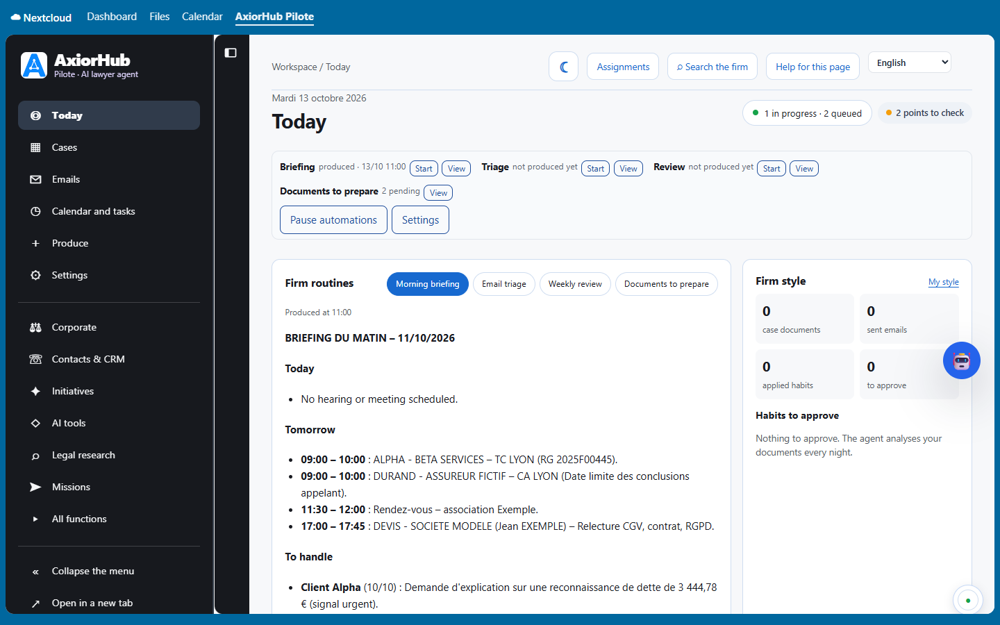
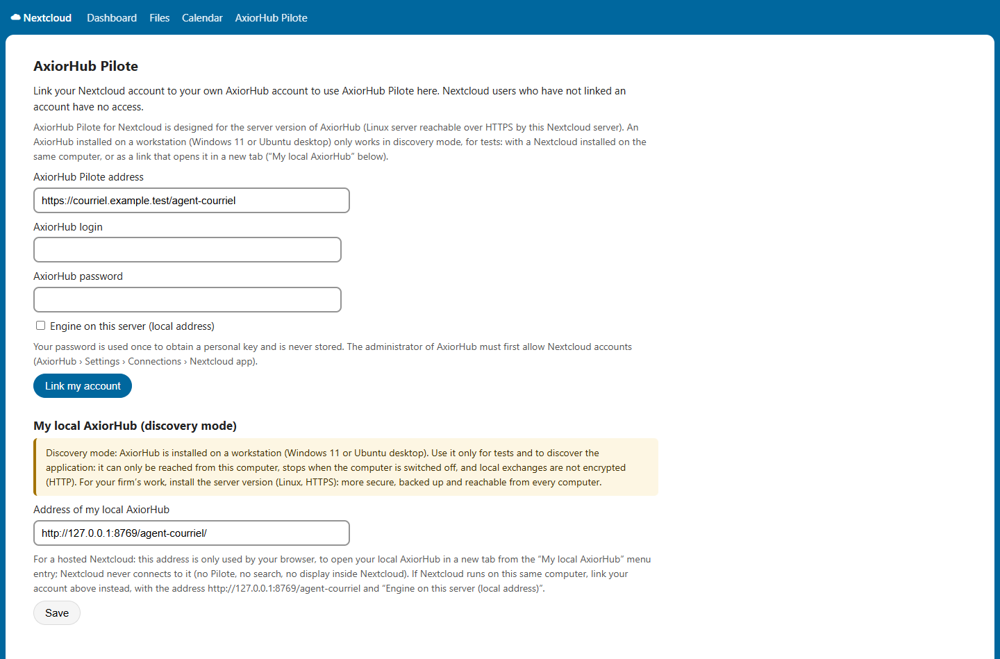
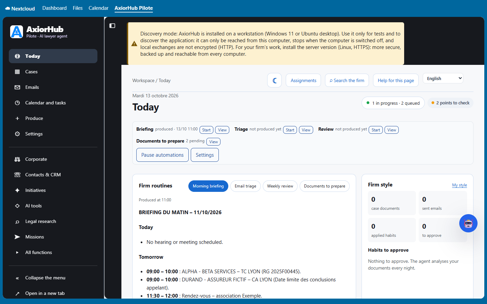
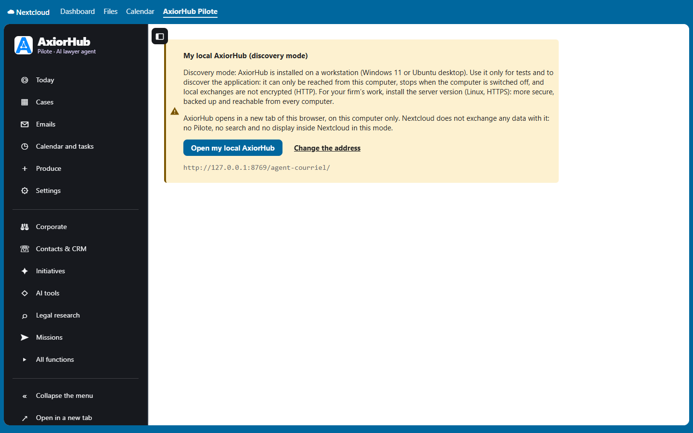

# AxiorHub Pilote for Nextcloud

[Français](README.md) · **English**

Nextcloud app that shows **the AxiorHub Pilote interface** — legal software designed for French lawyers (avocats) — right inside
Nextcloud: Today, cases, emails, calendar and tasks, deeds, Corporate, legal research, Pilot. Version 0.4.3 (development version), for
AxiorHub Pilote 5.6.42 or later. AxiorHub works with French procedure, courts and legal sources; its documents are written in French,
and its interface is also translated into English, German and Spanish.

**WARNING: EXPERIMENTAL VERSION**




**This app does not contain the engine.** It connects to an AxiorHub Pilote that is already installed. For your firm's work, that engine
is the **server version** (Linux, HTTPS). An AxiorHub installed on a workstation (Windows 11 or Ubuntu) can only be used in
**discovery mode**, for tests, with the limits described below.

## What the app does

- **The AxiorHub interface inside Nextcloud.** Once your account is linked, the **AxiorHub Pilote** entry of the Nextcloud top bar
  shows AxiorHub itself, with its sections in a left menu in the AxiorHub colours: Today, Cases, Emails, Calendar and tasks, Produce,
  Settings, Corporate, Contacts & CRM, Initiatives, AI tools, Legal research, Missions, All functions.
- **No password to type again.** The engine gives the linked account a single-use sign-in address (60 seconds), which the browser
  exchanges for a 12-hour AxiorHub session.
- **“Open in a new tab”** shows the same interface full screen; the menu can be collapsed (“Collapse the menu”), and the choice is
  remembered by the browser.
- **“Simplified view”**: instruction to the Pilot (answer, analysis, Word draft saved in the case folder or email draft — **nothing is
  sent**), search in the cases, case sheet, anonymised legal research, recent work.
- **Each lawyer links his or her own AxiorHub account**; Nextcloud users without a linked account have no access.
- The engine keeps the indexing, templates, missions and checks: the app **installs no Python, no Ollama and no processing server** in
  Nextcloud.

## Which setup should I choose?

| Setup | Use | What works |
|---|---|---|
| AxiorHub **server version** (Linux, HTTPS) + Nextcloud | **your firm's work (production)** — recommended | everything: interface inside Nextcloud, Pilot, search, every computer of the firm |
| AxiorHub **on a workstation** (Windows 11, Ubuntu) + Nextcloud **on the same computer** | **tests and discovery only** | the interface inside Nextcloud, from that computer only, with a permanent warning banner |
| AxiorHub **on a workstation** + **hosted** Nextcloud (on a server) | **tests and discovery only** | a simple “My local AxiorHub” link that opens AxiorHub in a new tab; no Pilot, no search, no display inside Nextcloud |

## Requirements

For the server version (discovery mode only needs a Windows 11 or Ubuntu 24.04 computer):

| Item | Requirement |
|---|---|
| Server | Linux **Ubuntu 24.04 LTS** or **Debian 12** (64-bit), `sudo` access |
| Memory and disk | 8 GB at least without local AI (32 GB and ideally a graphics card for a local AI); 80 GB of disk or more |
| Nextcloud | **32 to 35**, behind **Apache with HTTPS** (valid certificate), PHP 8.1 to 8.5, a Nextcloud administrator account |
| AxiorHub address | an **HTTPS** address the Nextcloud server can reach; simplest: `https://cloud.your-firm.example/agent-courriel/` (same domain as Nextcloud) |
| Accounts | the firm's mailbox settings (IMAP, SMTP); a technical Nextcloud account with an **app password** |
| Time | about 45 minutes |

## Step 1 — Install the AxiorHub server version (Linux)

On the server, as an administrator. Replace `cloud.your-firm.example` with your Nextcloud address.

```bash
# 1.1 Prepare the server
sudo apt update && sudo apt full-upgrade -y
sudo apt install -y git python3 python3-venv

# 1.2 Download AxiorHub Pilote and build the verified archive (checksum manifest checked by the installer)
sudo git clone --branch v5.6.42 https://github.com/Arthur-Llevelys/AxiorHub-Pilote.git /opt/axiorhub-src
cd /opt/axiorhub-src
sudo python3 scripts/build-release.py /tmp/axiorhub-mail-agent-5.6.42.tar.gz

# 1.3 Install (or update) the engine
cd /tmp && tar -xzf axiorhub-mail-agent-5.6.42.tar.gz && cd axiorhub-mail-agent-5.6.42
sudo bash install.sh

# 1.4 Configure the mailbox, Nextcloud and the AI, then check
sudo axiorhub-mail configure
sudo axiorhub-mail doctor

# 1.5 Publish the interface on the Nextcloud address (existing HTTPS name, password of at least 16 characters)
sudo python3 /opt/axiorhub-mail-agent/current/install-interface.py
```

AxiorHub then answers at `https://cloud.your-firm.example/agent-courriel/` (login `admin`). Its **Setup guide** (Settings › Setup guide)
then walks through the settings one screen at a time. For a new server (VPS) with Nextcloud, webmail and HTTPS, see the
[engine README](https://github.com/Arthur-Llevelys/AxiorHub-Pilote/blob/main/README.en.md#installation).

**1.6 Allow the app**: in AxiorHub, **Settings › Connections › Nextcloud app**, tick “Allow linking accounts from Nextcloud”, then
“Save”. Start in observation mode (nothing is written); nothing is ever sent without your click.

## Step 2 — Install the app from the Nextcloud App Store

As a Nextcloud administrator: **Apps › Office & text › AxiorHub Pilote › Download and enable** (or search for “AxiorHub Pilote”). On the
command line:

```bash
cd /path/to/nextcloud
sudo -u www-data php occ app:install axiorhub_pilote
```

Updates then appear in **Apps › Updates**.

### Without the App Store (manual installation)

As long as the app is not listed in your App Store, or on a server without access to it:

```bash
cd /tmp && git clone --branch v0.4.3 https://github.com/Arthur-Llevelys/AxiorHub-Pilote-Nextcloud.git axh-app
python3 axh-app/scripts/build-package.py /tmp/axiorhub_pilote-0.4.3.tar.gz
cd /path/to/nextcloud
sudo -u www-data tar -xzf /tmp/axiorhub_pilote-0.4.3.tar.gz -C apps
sudo -u www-data php occ app:enable axiorhub_pilote
```

Manual update: `occ app:disable axiorhub_pilote`, replace the `apps/axiorhub_pilote` folder the same way (web server account),
`occ app:enable axiorhub_pilote`, then `occ upgrade`.

## Step 3 — Link each lawyer's account

Each lawyer opens **Personal settings › AxiorHub Pilote** and enters:

1. the AxiorHub Pilote address (`https://cloud.your-firm.example/agent-courriel`);
2. his or her AxiorHub login and password;
3. then clicks “Link my account”.



The password is used **once** to obtain a personal key; it is neither stored nor logged. The key is encrypted in the user's preferences
and can be revoked on both sides (“Unlink” in Nextcloud, “Revoke” in AxiorHub). The **AxiorHub Pilote** icon of the Nextcloud top bar
then opens the AxiorHub interface.

If AxiorHub runs on the same server as Nextcloud and is reached through a local address (`http://127.0.0.1:…` of the server), tick
“Engine on this server (local address)”.

## Discovery mode: AxiorHub installed on a workstation (tests only)

To **try** AxiorHub without a server, install the workstation version:
[Windows 11](https://github.com/Arthur-Llevelys/AxiorHub-Pilote/blob/main/docs/INSTALLATION-WINDOWS.md) (installer
`AxiorHub-Pilote-Setup-5.6.42.exe`) or [Ubuntu 24.04](https://github.com/Arthur-Llevelys/AxiorHub-Pilote/blob/main/docs/GUIDE-POSTE-10-MINUTES.md)
(`sudo apt install ./axiorhub-pilote-poste_5.6.42_amd64.deb`); both guides are in French, and the
[engine README](https://github.com/Arthur-Llevelys/AxiorHub-Pilote/blob/main/README.en.md#installation) summarises them in English.
The workstation version only listens on its own computer (`http://127.0.0.1:8769`).

> **Warning — tests and discovery only, never for production.** AxiorHub can then only be reached from that computer, stops when the
> computer is switched off, and local exchanges are not encrypted (HTTP). For your firm's work, install the **server version** (Step 1):
> more secure (HTTPS), backed up and reachable from every computer.

**Nextcloud installed on the same computer** (native installation, or Docker Desktop on Windows):

1. in AxiorHub, **Settings › Connections › Nextcloud app**, tick “Allow linking accounts from Nextcloud (same computer)”; the same page
   shows the local login and password;
2. in Nextcloud, **Personal settings › AxiorHub Pilote**: address `http://127.0.0.1:8769/agent-courriel` (Docker Desktop:
   `http://host.docker.internal:8769/agent-courriel`), tick “Engine on this server (local address)”, enter the local login and password,
   then “Link my account”.

The AxiorHub interface then works inside Nextcloud, with a **permanent warning banner**:



**Hosted Nextcloud** (on a server): the Nextcloud server cannot reach your computer. In **Personal settings › AxiorHub Pilote › Address of
my local AxiorHub**, enter `http://127.0.0.1:8769/agent-courriel/`, then “Save”. The **My local AxiorHub** menu entry repeats the warning
and opens AxiorHub in a new tab of your browser; Nextcloud exchanges no data with your computer (no Pilot, no search, no display inside
Nextcloud).



Limit: a Nextcloud running in Docker **on Ubuntu** cannot reach the workstation's local address; install Nextcloud directly on the
workstation instead, or use “My local AxiorHub”.

## If something does not work

| Message | What to do |
|---|---|
| “AxiorHub cannot be reached from this Nextcloud server” | check the address (it usually ends with `/agent-courriel`), the HTTPS certificate and the firewall; a workstation installation cannot be reached from a hosted Nextcloud (discovery mode) |
| “AxiorHub installed on a workstation: it can only be used in discovery mode” | Nextcloud on the same computer, or “My local AxiorHub”; for your firm, install the server version (Step 1) |
| “The web server in front of AxiorHub asks for a login” | let `/agent-courriel/integration/v1/` and `/agent-courriel/nextcloud-session` through without login (signed or single-use calls) |
| “AxiorHub does not accept requests from Nextcloud” | Step 1.6 in AxiorHub |
| The interface stays blank inside Nextcloud | serve AxiorHub under the same domain as Nextcloud, or use “Open in a new tab” |

### Display inside Nextcloud: same domain recommended

AxiorHub is shown in a frame of the Nextcloud page. When AxiorHub and Nextcloud are served under the same domain (for example
`https://cloud.example.org/` and `https://cloud.example.org/agent-courriel/`), the session works in every browser. On two different
domains, the session is a “third-party” cookie (Secure, SameSite=None, Partitioned) that some browsers block; the app detects it and
offers “Open in a new tab”. A web server in front of AxiorHub must not add its own `X-Frame-Options` header to AxiorHub pages (the engine
sets `frame-ancestors` itself). The Docker distribution (firm accounts) asks for its own login: it opens in a tab.

### Instance mode (optional, inherited from 0.2.0)

Administration settings › Additional settings › AxiorHub: address, instance identifier and shared secret (at least 8 characters, the same
as `integration5634` on the engine), default group; the engine's cases are attached to Nextcloud groups. A user with a personal link
always goes through his or her personal key.

## Security

- Signed context on every call (HMAC-SHA256: personal key or instance secret, signed operation, 2-minute expiry, single-use nonce); the
  engine checks the account's rights again for every case, task and result.
- No redirect is followed; a non-JSON engine answer (waiting page, login page of a front server) is qualified (`moteur_occupe`,
  `acces_refuse_par_le_frontal`, `reponse_moteur_invalide`) instead of a misleading “cannot be reached”; a read is retried once when the
  engine is busy, a write never.
- Linking attempts limited by the engine (5 failures in 15 minutes).
- Files read through the public APIs (`IRootFolder`, nodes and permissions), never through the `data` directory.
- Interface inside Nextcloud: single-use sign-in address (60 s, only its hash is kept by the engine), 12-hour session (HttpOnly cookie
  limited to the AxiorHub path), revoked with the key; the Nextcloud page only allows the engine's origin in a frame, and the engine only
  accepts being framed by the key's Nextcloud site; a password login can never be framed.
- Discovery mode: a workstation engine only accepts calls coming from its own computer; the “My local AxiorHub” address is limited to
  `127.0.0.1`, `localhost` or `[::1]` and is never contacted by the Nextcloud server.
- Business routes protected against CSRF (no `NoCSRFRequired` or `PublicPage` outside the entry page).

## Compatibility and tests

Targets: Nextcloud 32 to 35; PHP 8.1 to 8.5 depending on the server version. On every push, the GitHub checks run the PHP syntax check
(8.1 and 8.4), the unit tests (`composer install`, `vendor/bin/phpunit -c phpunit-unit.xml`) and the interface build. The real
installation on each Nextcloud version (`nextcloud-app.yml` workflow) is started manually; **no compatibility is claimed** before it
succeeds. Signing and publishing on the App Store are the project maintainer's responsibility.

## Build

```
npm ci && npm run build      # compiled assets in js/ and css/
```

The release package (`scripts/build-package.py` in this repository, `scripts/build-nextcloud-app.py` in the engine repository) contains a
single `axiorhub_pilote` folder, the compiled assets, `appinfo`, `lib`, `templates`, `l10n`, `img`, the licence and this documentation;
no `node_modules`, no `vendor`, no development sources, no secret. Screenshots (`screenshots/`) only use fictitious data.

## Repositories

- Nextcloud app: https://github.com/Arthur-Llevelys/AxiorHub-Pilote-Nextcloud (app at the root; report issues in the “Issues” tab,
  without any firm data).
- Engine: https://github.com/Arthur-Llevelys/AxiorHub-Pilote, which keeps an identical copy of the app in `nextcloud-app/`.

Licence AGPL-3.0-or-later.
