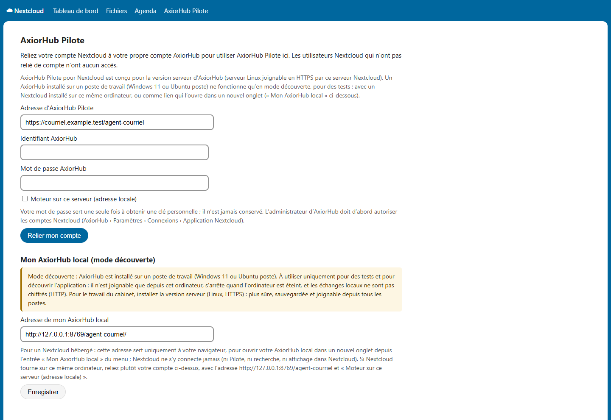
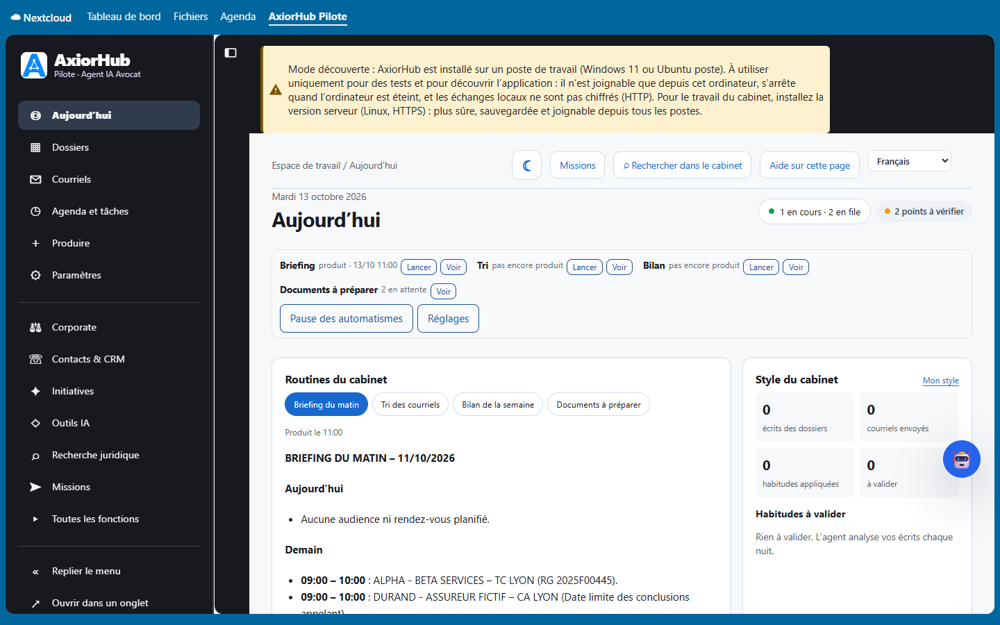
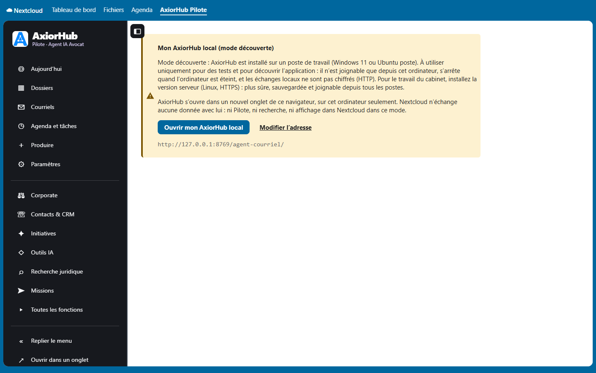

# AxiorHub Pilote pour Nextcloud

**Français** · [English](README.en.md)

Application Nextcloud qui affiche **l'interface d'AxiorHub Pilote** — logiciel juridique destiné aux avocats français — directement
dans Nextcloud : Aujourd'hui, dossiers, courriels, agenda et tâches, actes, Corporate, recherche juridique, Pilote. Version 0.4.3
(version de développement), pour AxiorHub Pilote 5.6.42 ou ultérieur.


**Cette application ne contient pas le moteur.** Elle se connecte à un AxiorHub Pilote déjà installé. Pour le travail du cabinet, ce
moteur est la **version serveur** (Linux, HTTPS). Un AxiorHub installé sur un poste de travail (Windows 11 ou Ubuntu) ne sert qu'en
**mode découverte**, pour des tests, avec les limites décrites plus bas.

## Ce que fait l'application

- **L'interface d'AxiorHub dans Nextcloud.** Après liaison du compte, l'entrée **AxiorHub Pilote** de la barre Nextcloud affiche
  AxiorHub lui-même, avec ses rubriques dans le menu de gauche aux couleurs d'AxiorHub : Aujourd'hui, Dossiers, Courriels, Agenda et
  tâches, Produire, Paramètres, Corporate, Contacts & CRM, Initiatives, Outils IA, Recherche juridique, Missions, Toutes les fonctions.
- **Aucun mot de passe à ressaisir.** Le moteur remet au compte relié une adresse de connexion à usage unique (60 secondes), échangée
  par le navigateur contre une session AxiorHub de 12 heures.
- **« Ouvrir dans un onglet »** affiche la même interface en plein écran ; le menu se replie (« Replier le menu ») et le choix est
  mémorisé dans le navigateur.
- **« Vue simplifiée »** : instruction au Pilote (réponse, analyse, projet Word déposé dans le dossier ou brouillon de courriel —
  **rien n'est envoyé**), recherche dans les dossiers, fiche du dossier, recherche juridique anonymisée, travaux récents.
- **Chaque avocat relie son propre compte AxiorHub** ; les utilisateurs Nextcloud qui n'ont pas relié de compte n'ont aucun accès.
- Le moteur garde l'indexation, les modèles, les missions et les contrôles : l'application **n'installe ni Python, ni Ollama, ni
  serveur de traitement** dans Nextcloud.

## Quelle configuration choisir ?

| Configuration | Usage | Ce qui fonctionne |
|---|---|---|
| **Version serveur** d'AxiorHub (Linux, HTTPS) + Nextcloud | **travail du cabinet (production)** — recommandé | tout : interface dans Nextcloud, Pilote, recherche, tous les postes du cabinet |
| AxiorHub **sur un poste** (Windows 11, Ubuntu) + Nextcloud **sur ce même ordinateur** | **tests et découverte seulement** | l'interface dans Nextcloud, depuis cet ordinateur seulement, avec un bandeau d'avertissement permanent |
| AxiorHub **sur un poste** + Nextcloud **hébergé** (sur un serveur) | **tests et découverte seulement** | un simple lien « Mon AxiorHub local » qui ouvre AxiorHub dans un onglet ; ni Pilote, ni recherche, ni affichage dans Nextcloud |

## Prérequis

Pour la version serveur (le mode découverte n'a besoin que d'un poste Windows 11 ou Ubuntu 24.04) :

| Élément | Exigence |
|---|---|
| Serveur | Linux **Ubuntu 24.04 LTS** ou **Debian 12** (64 bits), accès `sudo` |
| Mémoire et disque | 8 Go au moins sans IA locale (32 Go et idéalement une carte graphique pour une IA locale) ; 80 Go de disque ou plus |
| Nextcloud | **32 à 35**, derrière **Apache en HTTPS** (certificat valide), PHP 8.1 à 8.5, compte administrateur Nextcloud |
| Adresse d'AxiorHub | une adresse **HTTPS** joignable par le serveur Nextcloud ; le plus simple : `https://cloud.votre-cabinet.fr/agent-courriel/` (même domaine que Nextcloud) |
| Comptes | paramètres de la messagerie du cabinet (IMAP, SMTP) ; un compte Nextcloud technique avec **mot de passe d'application** |
| Durée | environ 45 minutes |

## Étape 1 — Installer la version serveur d'AxiorHub (Linux)

Sur le serveur, en administrateur. Remplacez `cloud.votre-cabinet.fr` par l'adresse de votre Nextcloud.

```bash
# 1.1 Préparer le serveur
sudo apt update && sudo apt full-upgrade -y
sudo apt install -y git python3 python3-venv

# 1.2 Télécharger AxiorHub Pilote et construire l'archive vérifiée (manifeste d'empreintes contrôlé par l'installateur)
sudo git clone --branch v5.6.42 https://github.com/Arthur-Llevelys/AxiorHub-Pilote.git /opt/axiorhub-src
cd /opt/axiorhub-src
sudo python3 scripts/build-release.py /tmp/axiorhub-mail-agent-5.6.42.tar.gz

# 1.3 Installer (ou mettre à jour) le moteur
cd /tmp && tar -xzf axiorhub-mail-agent-5.6.42.tar.gz && cd axiorhub-mail-agent-5.6.42
sudo bash install.sh

# 1.4 Configurer la messagerie, Nextcloud et l'IA, puis contrôler
sudo axiorhub-mail configure
sudo axiorhub-mail doctor

# 1.5 Publier l'interface sur l'adresse de Nextcloud (nom HTTPS existant, mot de passe de 16 caractères au moins)
sudo python3 /opt/axiorhub-mail-agent/current/install-interface.py
```

AxiorHub répond alors à `https://cloud.votre-cabinet.fr/agent-courriel/` (identifiant `admin`). Son **guide d'installation**
(Paramètres › Guide d'installation) reprend ensuite les réglages un écran à la fois. Pour un serveur neuf (VPS) avec Nextcloud, messagerie
web et HTTPS, voir le [README du moteur](https://github.com/Arthur-Llevelys/AxiorHub-Pilote#installer).

**1.6 Autoriser l'application** : dans AxiorHub, **Paramètres › Connexions › Application Nextcloud**, cochez « Autoriser la liaison des
comptes depuis Nextcloud » puis « Enregistrer ». Commencez en mode observation (rien n'est écrit) ; rien n'est jamais envoyé sans votre
clic.

## Étape 2 — Installer l'application depuis la boutique Nextcloud

En administrateur Nextcloud : **Applications › Bureautique et texte › AxiorHub Pilote › Télécharger et activer** (ou recherchez
« AxiorHub Pilote »). En ligne de commande :

```bash
cd /chemin/vers/nextcloud
sudo -u www-data php occ app:install axiorhub_pilote
```

Les mises à jour apparaissent ensuite dans **Applications › Mises à jour**.

### Sans la boutique (installation manuelle)

Tant que l'application n'apparaît pas dans votre boutique, ou sur un serveur sans accès à la boutique :

```bash
cd /tmp && git clone --branch v0.4.3 https://github.com/Arthur-Llevelys/AxiorHub-Pilote-Nextcloud.git axh-app
python3 axh-app/scripts/build-package.py /tmp/axiorhub_pilote-0.4.3.tar.gz
cd /chemin/vers/nextcloud
sudo -u www-data tar -xzf /tmp/axiorhub_pilote-0.4.3.tar.gz -C apps
sudo -u www-data php occ app:enable axiorhub_pilote
```

Mise à jour manuelle : `occ app:disable axiorhub_pilote`, remplacer le dossier `apps/axiorhub_pilote` de la même façon (compte du
serveur web), `occ app:enable axiorhub_pilote` puis `occ upgrade`.

## Étape 3 — Relier le compte de chaque avocat

Chaque avocat ouvre **Paramètres personnels › AxiorHub Pilote** et saisit :

1. l'adresse d'AxiorHub Pilote (`https://cloud.votre-cabinet.fr/agent-courriel`) ;
2. son identifiant et son mot de passe AxiorHub ;
3. puis clique sur « Relier mon compte ».



Le mot de passe sert **une seule fois** à obtenir une clé personnelle ; il n'est ni conservé, ni journalisé. La clé est chiffrée dans
les préférences de l'utilisateur et se révoque des deux côtés (« Délier » dans Nextcloud, « Révoquer » dans AxiorHub). L'icône
**AxiorHub Pilote** de la barre Nextcloud ouvre ensuite l'interface d'AxiorHub.

Si AxiorHub est sur le même serveur que Nextcloud et joint par une adresse locale (`http://127.0.0.1:…` du serveur), cochez « Moteur sur
ce serveur (adresse locale) ».

## Mode découverte : AxiorHub installé sur un poste de travail (tests seulement)

Pour **essayer** AxiorHub sans serveur, installez la version poste :
[Windows 11](https://github.com/Arthur-Llevelys/AxiorHub-Pilote/blob/main/docs/INSTALLATION-WINDOWS.md) (installateur
`AxiorHub-Pilote-Setup-5.6.42.exe`) ou [Ubuntu 24.04](https://github.com/Arthur-Llevelys/AxiorHub-Pilote/blob/main/docs/GUIDE-POSTE-10-MINUTES.md)
(`sudo apt install ./axiorhub-pilote-poste_5.6.42_amd64.deb`). Elle n'écoute que son propre ordinateur (`http://127.0.0.1:8769`).

> **Avertissement — tests et découverte seulement, jamais pour la production.** AxiorHub n'est alors joignable que depuis cet ordinateur,
> s'arrête quand l'ordinateur est éteint, et les échanges locaux ne sont pas chiffrés (HTTP). Pour le travail du cabinet, installez la
> **version serveur** (étape 1) : plus sûre (HTTPS), sauvegardée et joignable depuis tous les postes.

**Nextcloud installé sur le même ordinateur** (installation classique, ou Docker Desktop sous Windows) :

1. dans AxiorHub, **Paramètres › Connexions › Application Nextcloud**, cochez « Autoriser la liaison des comptes depuis Nextcloud (même
   ordinateur) » ; la même page affiche l'identifiant et le mot de passe locaux ;
2. dans Nextcloud, **Paramètres personnels › AxiorHub Pilote** : adresse `http://127.0.0.1:8769/agent-courriel` (Docker Desktop :
   `http://host.docker.internal:8769/agent-courriel`), cochez « Moteur sur ce serveur (adresse locale) », saisissez l'identifiant et le
   mot de passe locaux, puis « Relier mon compte ».

L'interface d'AxiorHub fonctionne alors dans Nextcloud, avec un **bandeau d'avertissement permanent** :



**Nextcloud hébergé** (sur un serveur) : le serveur Nextcloud ne peut pas joindre votre ordinateur. Dans **Paramètres personnels ›
AxiorHub Pilote › Adresse de mon AxiorHub local**, saisissez `http://127.0.0.1:8769/agent-courriel/` puis « Enregistrer ». L'entrée
**Mon AxiorHub local** du menu rappelle l'avertissement et ouvre AxiorHub dans un nouvel onglet de votre navigateur ; Nextcloud n'échange
aucune donnée avec votre ordinateur (ni Pilote, ni recherche, ni affichage dans Nextcloud).



Limite : un Nextcloud dans Docker **sous Ubuntu** ne joint pas l'adresse locale du poste ; installez alors Nextcloud directement sur le
poste, ou utilisez « Mon AxiorHub local ».

## En cas de difficulté

| Message | Que faire |
|---|---|
| « AxiorHub est injoignable depuis ce serveur Nextcloud » | vérifier l'adresse (elle se termine en général par `/agent-courriel`), le certificat HTTPS, le pare-feu ; une installation sur un poste de travail n'est pas joignable depuis un Nextcloud hébergé (mode découverte) |
| « AxiorHub installé sur un poste de travail : utilisable seulement en mode découverte » | Nextcloud sur le même ordinateur ou « Mon AxiorHub local » ; pour le cabinet, installer la version serveur (étape 1) |
| « Le serveur web placé devant AxiorHub demande une connexion » | autoriser sans connexion `/agent-courriel/integration/v1/` et `/agent-courriel/nextcloud-session` (appels signés ou à usage unique) |
| « AxiorHub n'accepte pas les demandes de Nextcloud » | étape 1.6 dans AxiorHub |
| L'interface reste blanche dans Nextcloud | servir AxiorHub sous le même domaine que Nextcloud, ou « Ouvrir dans un onglet » |

### Affichage dans Nextcloud : même domaine recommandé

AxiorHub s'affiche dans un cadre de la page Nextcloud. Quand AxiorHub et Nextcloud sont servis sous le même domaine (par exemple
`https://cloud.exemple.fr/` et `https://cloud.exemple.fr/agent-courriel/`), la session fonctionne dans tous les navigateurs. Sur deux
domaines différents, la session est un cookie « tiers » (Secure, SameSite=None, Partitioned) : certains navigateurs le bloquent ;
l'application le détecte et propose « Ouvrir dans un onglet ». Un serveur web placé devant AxiorHub ne doit pas ajouter son propre
en-tête `X-Frame-Options` aux pages d'AxiorHub (le moteur règle lui-même `frame-ancestors`). La distribution Docker (comptes du cabinet)
demande sa propre connexion : elle s'ouvre dans un onglet.

### Mode d'instance (facultatif, hérité de 0.2.0)

Paramètres d'administration › Paramètres supplémentaires › AxiorHub : adresse, identifiant d'instance et secret partagé (8 caractères
au moins, identiques à `integration5634` sur le moteur), groupe par défaut ; les dossiers du moteur sont rattachés à des groupes
Nextcloud. Un utilisateur relié personnellement passe toujours par sa clé personnelle.

## Sécurité

- Contexte signé à chaque appel (HMAC-SHA256 : clé personnelle ou secret d'instance, opération signée, expiration de 2 minutes, nonce
  à usage unique) ; le moteur revérifie les droits du compte pour chaque dossier, travail et résultat.
- Aucune redirection suivie ; une réponse non JSON du moteur (page d'attente, page de connexion d'un frontal) est qualifiée
  (`moteur_occupe`, `acces_refuse_par_le_frontal`, `reponse_moteur_invalide`) au lieu d'un « injoignable » trompeur ; une lecture est
  réessayée une fois quand le moteur est occupé, une écriture jamais.
- Essais de liaison limités par le moteur (5 échecs en 15 minutes).
- Fichiers lus par les API publiques (`IRootFolder`, nœuds et permissions), jamais par le répertoire `data`.
- Interface dans Nextcloud : adresse de connexion à usage unique (60 s, empreinte seule conservée par le moteur), session de 12 heures
  (cookie HttpOnly limité au chemin d'AxiorHub), révoquée avec la clé ; la page Nextcloud n'autorise dans un cadre que l'origine du
  moteur, et le moteur n'accepte d'être affiché que dans le site Nextcloud de la clé ; une connexion par mot de passe reste interdite
  de cadre.
- Mode découverte : un moteur poste n'accepte que les appels venus de son propre ordinateur ; l'adresse « Mon AxiorHub local » est
  limitée à `127.0.0.1`, `localhost` ou `[::1]` et n'est jamais contactée par le serveur Nextcloud.
- Routes métier avec protection CSRF (aucun `NoCSRFRequired` ni `PublicPage` hors de la page d'entrée).

## Compatibilité et tests

Cibles : Nextcloud 32 à 35 ; PHP 8.1 à 8.5 selon la version du serveur. À chaque envoi, la recette GitHub exécute la syntaxe PHP
(8.1 et 8.4), les tests unitaires (`composer install`, `vendor/bin/phpunit -c phpunit-unit.xml`) et la construction de l'interface.
L'installation réelle sur chaque version de Nextcloud (workflow `nextcloud-app.yml`) se lance manuellement ; **aucune compatibilité
n'est annoncée** avant son succès. La signature et la publication sur l'App Store relèvent du responsable du projet.

## Construire

```
npm ci && npm run build      # actifs compilés dans js/ et css/
```

Le paquet de diffusion (`scripts/build-package.py` dans le dépôt dédié, `scripts/build-nextcloud-app.py` dans le dépôt du moteur)
contient un seul dossier `axiorhub_pilote`, les actifs compilés, `appinfo`, `lib`, `templates`, `l10n`, `img`, la licence et cette
documentation ; ni `node_modules`, ni `vendor`, ni sources de développement, ni secret. Les captures d'écran (`screenshots/`)
n'utilisent que des données fictives.

## Dépôts

- Application Nextcloud : https://github.com/Arthur-Llevelys/AxiorHub-Pilote-Nextcloud (application à la racine ; signalements dans
  l'onglet « Issues », sans aucune donnée du cabinet).
- Moteur : https://github.com/Arthur-Llevelys/AxiorHub-Pilote, qui garde une copie identique de l'application dans `nextcloud-app/`.

Licence AGPL-3.0-or-later.
